# 실습과제 1

## box.hpp
```cpp
#ifndef _BOX_HPP_
#define _BOX_HPP_
...
#endif
```
- 헤더파일 중복 포함 방지

```cpp
template <class T>
class Box {
    T val;
public:
    Box(T v);
    T getValue();
    void setValue(T v);
};
```
- 템플릿 매개변수 T로 상자에 담을 값의 타입을 일반화
- T 타입 멤버변수 val 하나를 가짐
- 값을 받는 생성자, 값을 리턴하는 getValue(), 값을 바꾸는 setValue() 선언

```cpp
template <class T>
Box<T>::Box(T v) {
    val = v;
}
```
- 클래스 밖에서 멤버함수를 구현할 때는 함수마다 template <class T>를 붙이고 클래스 이름을 Box<T>로 씀
- 매개변수 v를 멤버변수 val에 저장

```cpp
template <class T>
T Box<T>::getValue() {
    return val;
}

template <class T>
void Box<T>::setValue(T v) {
    val = v;
}
```
- 저장된 값을 T 타입으로 리턴
- 새 값으로 변경

## main.cpp
```cpp
#include <iostream>
#include <string>
#include "box.hpp"
```
- std::string을 사용하기 위해 string 헤더 포함
- 문제에 주어진 main()이 std::를 붙여 쓰므로 using namespace std;는 쓰지 않음

```cpp
Box<int> intBox(100);
Box<double> doubleBox(3.14);
```
- T가 int, double로 구체화된 Box 클래스의 객체 생성

```cpp
Box<std::string> strBox("안녕하세요");
strBox.setValue("템플릿 기초 완료!");
```
- T가 string으로 구체화, 문자열 리터럴이 string으로 변환되어 생성자와 setValue()에 전달됨

## Makefile
```makefile
CX = g++
CXFLAGS = -g -Wall
OBJS = main.o
TARGET = box
```
- 템플릿 클래스는 헤더파일에만 있으므로 컴파일할 소스파일은 main.cpp 하나, 목적파일도 main.o 하나

```makefile
$(TARGET) : $(OBJS)
	$(CX) -o $(TARGET) $(OBJS)
```
- 첫 번째 rule, g++ -o box main.o로 링크

```makefile
main.o : main.cpp box.hpp
	$(CX) $(CXFLAGS) -c main.cpp
```
- main.o는 main.cpp와 box.hpp에 의존, 템플릿 클래스를 수정하면 main.cpp가 다시 컴파일됨

```makefile
.PHONY: clean
clean :
	rm $(TARGET) $(OBJS)
```
- make clean 입력 시 실행파일과 목적파일 삭제

## 실행결과

| 구분 | 이미지 |
| --- | --- |
| box.hpp | 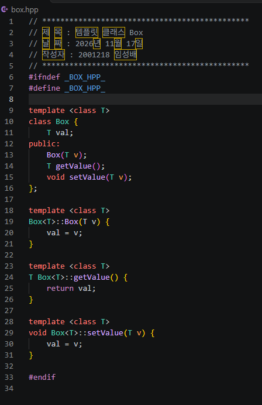 |
| main.cpp | 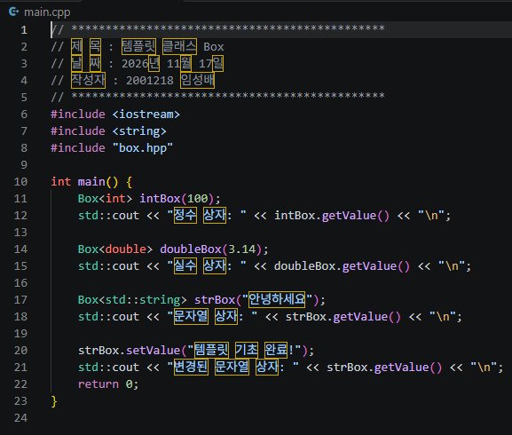 |
| Makefile | 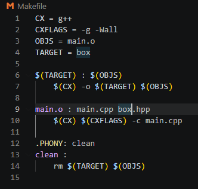 |
| 실행결과 | 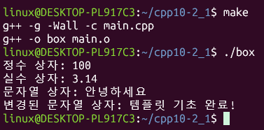 |

# 실습과제 2
예제2를 참고하여 아래 결과가 나오도록 템플릿 클래스 GClass를 정의하시오. 멤버 함수 swap를 추가할 것

## gclass.hpp
```cpp
#ifndef _GCLASS_HPP_
#define _GCLASS_HPP_
...
#endif
```
- 헤더파일 중복 포함 방지

```cpp
template <class T1, class T2>
class GClass {
    T1 data1;
    T2 data2;
public:
    GClass();
    void set(T1 a, T2 b);
    void get(T1& a, T2& b);
    void swap();
};
```
- 템플릿 매개변수가 T1, T2 두 개인 템플릿 클래스
- data1은 T1 타입, data2는 T2 타입
- 예제2와 같이 생성자, set(), get()을 선언하고 두 값을 교환하는 swap()을 추가

```cpp
template <class T1, class T2>
GClass<T1, T2>::GClass() {
    data1 = 0;
    data2 = 0;
}
```
- 두 멤버를 0으로 초기화, 구현할 때 클래스 이름은 GClass<T1, T2>

```cpp
template <class T1, class T2>
void GClass<T1, T2>::set(T1 a, T2 b) { ... }

template <class T1, class T2>
void GClass<T1, T2>::get(T1& a, T2& b) {
    a = data1;
    b = data2;
}
```
- set()은 두 값을 저장
- get()은 참조 매개변수로 받아서 저장된 값을 main()의 변수에 직접 넣어줌

```cpp
template <class T1, class T2>
void GClass<T1, T2>::swap() {
    T1 tmp = data1;
    data1 = data2;
    data2 = tmp;
}
```
- **추가한 함수**, 임시 변수 tmp에 data1을 보관한 뒤 data1에 data2를, data2에 tmp를 넣어 두 값을 교환
- data1과 data2를 서로 대입하므로 T1과 T2가 같은 타입(또는 서로 변환 가능한 타입)일 때 사용 가능, main()에서 GClass<int, int>, GClass<double, double>로 사용

## main.cpp
```cpp
GClass<int, int> x;
x.set(2, 5);
x.get(a, b);
...
x.swap();
x.get(a, b);
```
- T1, T2가 모두 int로 구체화, 2와 5를 저장했다가 swap() 후 5와 2로 바뀐 값을 가져옴

```cpp
GClass<double, double> y;
y.set(3.14, 6.28);
...
y.swap();
```
- T1, T2가 모두 double로 구체화, 같은 방식으로 교환

```cpp
cout << "a=" << a << '\t' << "b=" << b << endl;
```
- '\t'는 탭 문자로 a와 b 사이를 띄움

## Makefile
```makefile
CX = g++
CXFLAGS = -g -Wall
OBJS = main.o
TARGET = gclass
```
- 템플릿 클래스는 헤더파일에만 있으므로 컴파일할 소스파일은 main.cpp 하나, 목적파일도 main.o 하나

```makefile
$(TARGET) : $(OBJS)
	$(CX) -o $(TARGET) $(OBJS)
```
- 첫 번째 rule, g++ -o gclass main.o로 링크

```makefile
main.o : main.cpp gclass.hpp
	$(CX) $(CXFLAGS) -c main.cpp
```
- main.o는 main.cpp와 gclass.hpp에 의존, 템플릿 클래스를 수정하면 main.cpp가 다시 컴파일됨

```makefile
.PHONY: clean
clean :
	rm $(TARGET) $(OBJS)
```
- make clean 입력 시 실행파일과 목적파일 삭제

## 실행결과

| 구분 | 이미지 |
| --- | --- |
| gclass.hpp | 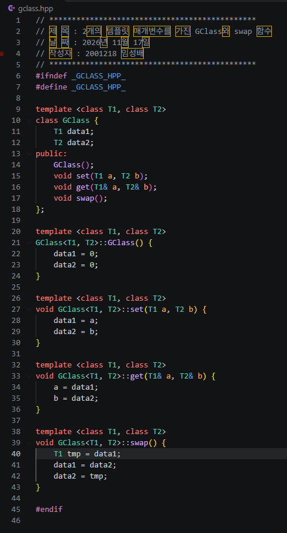 |
| main.cpp | 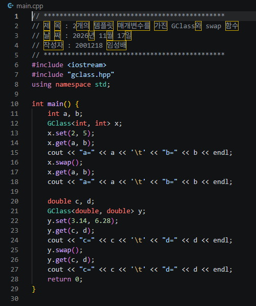 |
| Makefile | 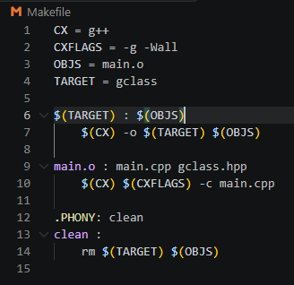 |
| 실행결과 | 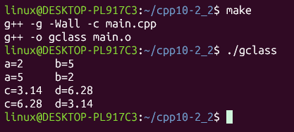 |

# 실습과제 3

| 문제 | 답 |
| --- | --- |
| (1) 빈칸 채우기 | `T* p;`, `int size;` |
| (2) 생성자 | `p = new T[n]; size = n;` |
| (3) 소멸자 | `delete[] p;` |
| (4) get() | `return p[index];` |
| (5) 객체 선언문 | `Container<char> c(26);` |
| (6) main() | 아래 main.cpp |

## container.hpp
```cpp
#ifndef _CONTAINER_HPP_
#define _CONTAINER_HPP_
...
#endif
```
- 헤더파일 중복 포함 방지

```cpp
template <class T>
class Container {
    T* p;
    int size;
```
- T 타입의 포인터 p, 동적 배열의 시작 주소를 저장
- 배열의 크기를 나타내는 변수 size

```cpp
public:
    Container(int n);
    ~Container();
    void set(int index, T value) { p[index] = value; }
    T get(int index);
};
```
- 교재에 주어진 선언, set()은 클래스 안에 바로 구현되어 있음(인라인)

```cpp
template <class T>
Container<T>::Container(int n) {
    p = new T[n];
    size = n;
}
```
- 생성자, new로 T 타입 원소 n개의 배열을 동적 할당하여 시작 주소를 p에 저장
- 배열의 크기 n을 size에 저장

```cpp
template <class T>
Container<T>::~Container() {
    delete[] p;
}
```
- 소멸자, 객체가 소멸될 때 생성자에서 할당한 배열을 반환
- 배열을 할당했으므로 delete가 아닌 delete[]를 사용, 반환하지 않으면 메모리 누수 발생

```cpp
template <class T>
T Container<T>::get(int index) {
    return p[index];
}
```
- index 위치의 값을 T 타입으로 리턴

## main.cpp
```cpp
Container<char> c(26);
```
- **(5)** T가 char로 구체화된 Container 객체 c 생성, 생성자 Container(26)이 호출되어 char 26개의 배열이 할당됨

```cpp
for (int i = 0; i < 26; i++)
    c.set(i, 'a' + i);
```
- **(6)** 'a' + i는 아스키코드 계산으로 i가 0이면 'a', 25이면 'z'
- set()으로 0번부터 25번까지 'a' ~ 'z'를 차례로 저장

```cpp
for (int i = 25; i >= 0; i--)
    cout << c.get(i);
cout << endl;
```
- **(6)** 25번부터 0번까지 거꾸로 get()으로 꺼내 출력하므로 z부터 a까지 반대순으로 출력됨

```cpp
return 0;
}
```
- main()이 끝나면 c가 소멸되면서 소멸자가 호출되어 동적 배열이 반환됨

## Makefile
```makefile
CX = g++
CXFLAGS = -g -Wall
OBJS = main.o
TARGET = container
```
- 템플릿 클래스는 헤더파일에만 있으므로 컴파일할 소스파일은 main.cpp 하나, 목적파일도 main.o 하나

```makefile
$(TARGET) : $(OBJS)
	$(CX) -o $(TARGET) $(OBJS)
```
- 첫 번째 rule, g++ -o container main.o로 링크

```makefile
main.o : main.cpp container.hpp
	$(CX) $(CXFLAGS) -c main.cpp
```
- main.o는 main.cpp와 container.hpp에 의존, 템플릿 클래스를 수정하면 main.cpp가 다시 컴파일됨

```makefile
.PHONY: clean
clean :
	rm $(TARGET) $(OBJS)
```
- make clean 입력 시 실행파일과 목적파일 삭제

## 실행결과

| 구분 | 이미지 |
| --- | --- |
| container.hpp | 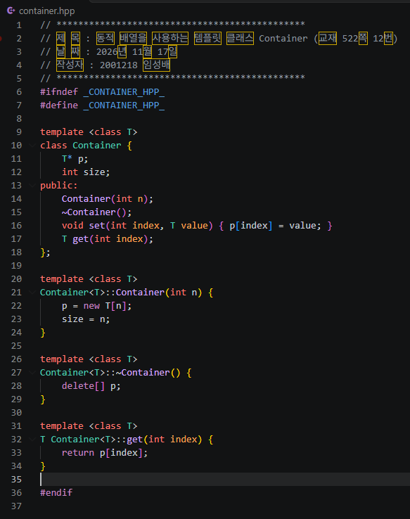 |
| main.cpp | 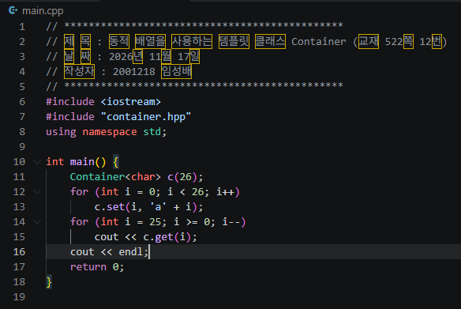 |
| Makefile | 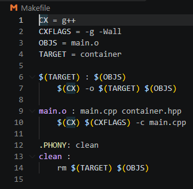 |
| 실행결과 | 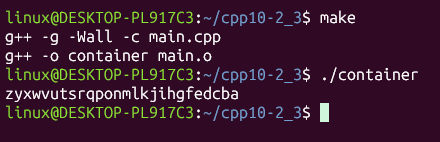 |

# 실습과제 4

## myqueue.hpp
```cpp
#ifndef _MYQUEUE_HPP_
#define _MYQUEUE_HPP_
...
#endif
```
- 헤더파일 중복 포함 방지

```cpp
template <class T>
class MyQueue {
    int front;
    int rear;
    int count;
    T data[100];
```
- front는 다음에 꺼낼 원소의 위치, rear는 다음에 넣을 원소의 위치
- count는 큐에 들어 있는 원소의 개수, 비었는지(0) 꽉 찼는지(100) 판단에 사용
- 예제 10-5처럼 T 타입 배열을 사용하며 큐의 크기는 100

```cpp
public:
    MyQueue();
    void enqueue(T element);
    T dequeue();
    bool isEmpty();
};
```
- 생성자, 삽입 함수 enqueue(), 삭제 함수 dequeue(), 큐가 비었는지 확인하는 isEmpty() 선언

```cpp
template <class T>
MyQueue<T>::MyQueue() {
    front = 0;
    rear = 0;
    count = 0;
}
```
- front, rear를 0으로, 원소 개수를 0으로 초기화하여 빈 큐로 시작

```cpp
template <class T>
void MyQueue<T>::enqueue(T element) {
    if (count == 100) {
        cout << "queue full" << endl;
        return;
    }
    data[rear] = element;
    rear = (rear + 1) % 100;
    count++;
}
```
- 큐가 꽉 찼으면 오류를 표시하고 종료
- rear 위치에 원소를 저장하고 rear를 다음 칸으로 이동
- % 100으로 배열 끝(99)에 도달하면 0번으로 돌아가는 원형 큐, 앞쪽에서 꺼내 비워진 칸을 다시 사용할 수 있음

```cpp
template <class T>
T MyQueue<T>::dequeue() {
    if (count == 0) {
        cout << "queue empty" << endl;
        return T();
    }
    T retData = data[front];
    front = (front + 1) % 100;
    count--;
    return retData;
}
```
- 큐가 비었으면 오류를 표시하고 T()를 리턴
- T()는 T 타입의 기본값(int는 0, string은 빈 문자열), 예제 10-5처럼 return 0;을 쓰면 T가 string일 때 컴파일 에러가 발생할 수 있으므로 T()를 사용
- front 위치의 원소, 즉 가장 먼저 들어온 원소를 꺼내고 front를 다음 칸으로 이동

```cpp
template <class T>
bool MyQueue<T>::isEmpty() {
    return count == 0;
}
```
- 원소가 없으면 true 리턴, main()에서 큐가 빌 때까지 꺼낼 때 사용

## main.cpp
```cpp
MyQueue<int> iQueue;
iQueue.enqueue(1);
iQueue.enqueue(2);
iQueue.enqueue(3);
while (!iQueue.isEmpty())
    cout << iQueue.dequeue() << ' ';
```
- int 큐에 1, 2, 3을 넣고 빌 때까지 꺼냄
- 넣은 순서 그대로 1 2 3이 출력되어 선입 선출 확인

```cpp
MyQueue<double> dQueue;
...
MyQueue<char>* p = new MyQueue<char>();
...
delete p;
```
- 예제 10-5와 같이 double 큐와, new로 동적 생성한 char 큐도 테스트
- 동적으로 생성한 객체는 delete로 반환

```cpp
MyQueue<string> sQueue;
sQueue.enqueue("first");
sQueue.enqueue("second");
```
- T가 string일 때도 동작하는지 확인

```cpp
iQueue.dequeue();
```
- 이미 비어 있는 큐에서 꺼내면 queue empty 오류 메시지가 출력되는지 확인

## Makefile
```makefile
CX = g++
CXFLAGS = -g -Wall
OBJS = main.o
TARGET = myqueue
```
- 템플릿 클래스는 헤더파일에만 있으므로 컴파일할 소스파일은 main.cpp 하나, 목적파일도 main.o 하나

```makefile
$(TARGET) : $(OBJS)
	$(CX) -o $(TARGET) $(OBJS)
```
- 첫 번째 rule, g++ -o myqueue main.o로 링크

```makefile
main.o : main.cpp myqueue.hpp
	$(CX) $(CXFLAGS) -c main.cpp
```
- main.o는 main.cpp와 myqueue.hpp에 의존, 템플릿 클래스를 수정하면 main.cpp가 다시 컴파일됨

```makefile
.PHONY: clean
clean :
	rm $(TARGET) $(OBJS)
```
- make clean 입력 시 실행파일과 목적파일 삭제

## 실행결과

| 구분 | 이미지 |
| --- | --- |
| myqueue.hpp | 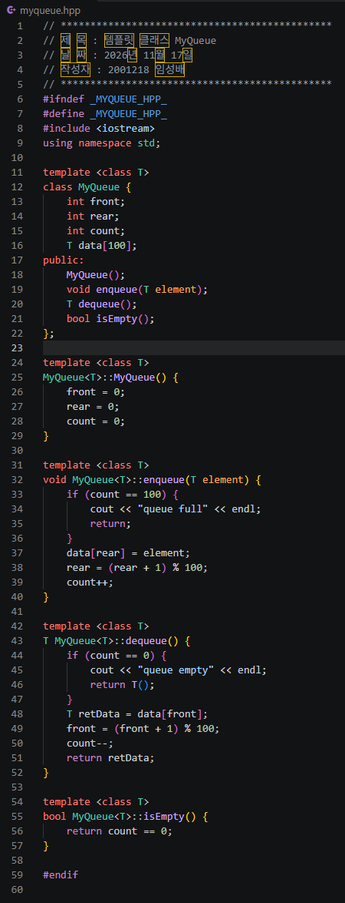 |
| main.cpp | 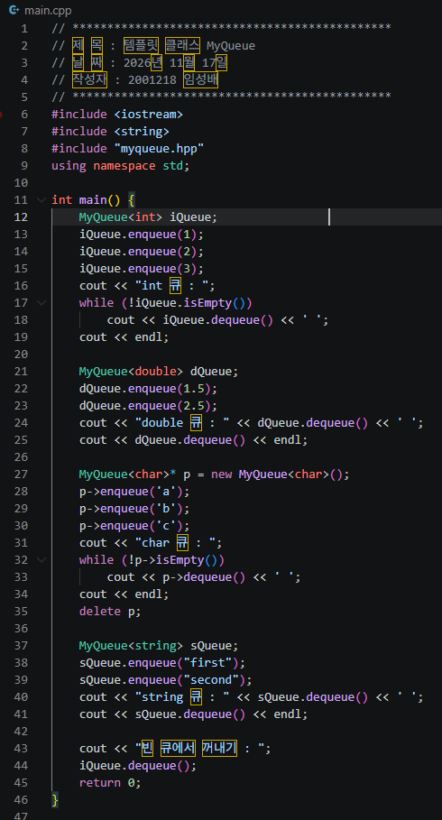 |
| Makefile | 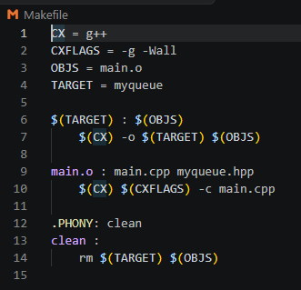 |
| 실행결과 | 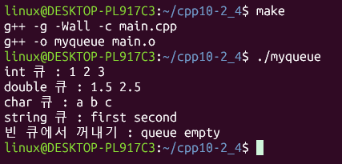 |

