# 10장 STL vector 실습과제

모든 과제는 리눅스에서 분할컴파일 구조로 작성하고 make로 빌드함

| 폴더 | 내용 |
| --- | --- |
| src/cpp10-3_2 | 실습과제 2, 최대값과 최소값 |
| src/cpp10-3_3 | 실습과제 3, 사전에서 제일 뒤에 나오는 단어 |
| src/cpp10-3_4 | 실습과제 4, 음수 삭제 후 평균값 |

- 실습과제 2~4는 클래스가 없으므로 헤더파일에는 함수 선언부, 소스파일에는 함수 구현부를 작성함
- 배열표현 사용금지 조건에 따라 `v[i]` 대신 vector의 멤버함수(push_back, front, begin, end, erase, size, empty)와 iterator만 사용함

# 실습과제 1
## STL 라이브러리에서 컨테이너 클래스, 이터레이터 클래스, 알고리즘 함수의 역할을 각각 설명하시오.
| 구성 요소 | 역할 | 예 |
| --- | --- | --- |
| 컨테이너 클래스 | 여러 개의 데이터(원소)를 저장하고 관리하는 자료구조를 템플릿 클래스로 구현한 것, 원소의 삽입, 삭제, 검색 기능을 멤버함수로 제공 | vector, list, deque, map, set, stack, queue |
| 이터레이터 클래스 | 컨테이너의 원소를 하나씩 가리키며 순회(접근)하는 포인터와 비슷한 객체, 컨테이너의 내부 구조와 관계없이 같은 방법(*, ++, !=)으로 원소에 접근하게 해 줌 | vector<int>::iterator, list<int>::iterator |
| 알고리즘 함수 | 컨테이너의 원소를 대상으로 검색, 정렬, 복사, 변경 등을 수행하는 템플릿 함수, 컨테이너의 멤버함수가 아니며 이터레이터로 범위를 지정하여 사용 | sort, find, reverse, max_element, count |

- 알고리즘 함수는 이터레이터를 매개변수로 받으므로 어떤 컨테이너든 이터레이터만 제공하면 같은 알고리즘을 사용할 수 있음 (예: `sort(v.begin(), v.end());`)
- 즉 이터레이터가 컨테이너와 알고리즘을 연결하는 다리 역할을 함

## 포인터와 iterator의 공통점과 차이점은 각각 무엇인가?
| 구분 | 내용 |
| --- | --- |
| 공통점 | 원소의 위치를 가리키며, `*it`로 가리키는 원소에 접근하고 `it++`로 다음 원소로 이동함, `==`, `!=`로 비교 가능, 같은 방식의 반복문으로 원소를 순회할 수 있음 |
| 차이점 1 (정체) | 포인터는 메모리 주소를 저장하는 변수, iterator는 컨테이너마다 정의된 클래스의 객체로 *, ++ 등의 연산자가 중복 정의되어 포인터처럼 동작함 |
| 차이점 2 (대상) | 포인터는 메모리의 어떤 주소든 가리킬 수 있음, iterator는 해당 컨테이너의 원소만 가리킬 수 있음 |
| 차이점 3 (구조) | 포인터의 ++는 항상 다음 메모리 주소로 이동하므로 원소가 연속된 배열에서만 순회 가능, iterator의 ++는 list처럼 원소가 메모리에 흩어져 있는 컨테이너에서도 다음 원소로 이동함 |
| 차이점 4 (연산) | 포인터는 +, -, <, > 등 모든 주소 연산이 가능, iterator는 컨테이너 종류에 따라 가능한 연산이 다름 (vector는 + n, < 가능, list는 ++, -- 만 가능) |

## vector 클래스의 erase, insert 멤버함수의 매개변수, 리턴값, 기능을 설명하시오.
| 함수 | 매개변수 | 리턴값 | 기능 |
| --- | --- | --- | --- |
| `erase(it)` | 삭제할 원소를 가리키는 iterator | 삭제된 원소의 **다음 원소**를 가리키는 iterator | it가 가리키는 원소를 삭제하고 뒤의 원소들을 앞으로 당김, 벡터 크기가 1 줄어듦 |
| `erase(first, last)` | 삭제할 범위의 시작과 끝 iterator | 삭제된 마지막 원소의 다음 원소를 가리키는 iterator | [first, last) 범위, 즉 first부터 last 바로 앞까지의 원소를 삭제 |
| `insert(it, value)` | 삽입할 위치의 iterator, 삽입할 값 | **삽입된 원소**를 가리키는 iterator | it가 가리키는 위치 앞에 value를 삽입하고 뒤의 원소들을 한 칸씩 뒤로 밂, 벡터 크기가 1 늘어남 |
| `insert(it, n, value)` | 삽입할 위치, 개수, 값 | 삽입된 첫 원소를 가리키는 iterator | it 위치 앞에 value를 n개 삽입 |

- erase와 insert를 실행하면 원소가 이동하므로 기존 iterator는 무효가 됨, 그래서 반복문에서는 `it = v.erase(it);`처럼 리턴값을 다시 받아서 사용해야 함

```cpp
vector<int> v = {1, 2, 3};
vector<int>::iterator it = v.begin() + 1;  // 2를 가리킴
it = v.erase(it);      // 2 삭제, v = {1, 3}, it는 3을 가리킴
it = v.insert(it, 9);  // 3 앞에 9 삽입, v = {1, 9, 3}, it는 9를 가리킴
```
- erase는 다음 원소를, insert는 삽입된 원소를 가리키는 iterator를 리턴

## vector<T>::end() 함수는 마지막원소의 다음원소를 가리키는 iterator를 반환하는가?
- **예.** end()는 마지막 원소가 아니라 마지막 원소의 **다음 위치**(past-the-end)를 가리키는 iterator를 리턴함
- 이 위치에는 실제 원소가 없으므로 `*v.end()`처럼 참조하면 안 됨
- begin()부터 end() 바로 앞까지가 원소의 범위가 되므로 반복문의 종료 조건을 `it != v.end()`로 간단히 쓸 수 있음
- 벡터가 비어 있으면 begin()과 end()가 같으므로 반복문이 한 번도 실행되지 않음
- 마지막 원소는 `*(v.end() - 1)` 또는 `v.back()`으로 접근함

## Iterator 객체를 이용한 반복문에서 조건문에 it != v.end(); 대신에 it <= v.end(); 쓰면 어떻게 되는가?
```cpp
for (it = v.begin(); it <= v.end(); it++)
    cout << *it << " ";
```
- vector의 iterator는 < , <= 비교 연산을 지원하므로 **컴파일 에러는 발생하지 않음**
- 하지만 it가 v.end()와 같을 때도 조건이 참이 되어 반복문이 한 번 더 실행됨
- 이때 `*it`는 마지막 원소의 다음 위치, 즉 존재하지 않는 원소를 참조하게 됨
- 결과는 **정의되지 않은 동작(undefined behavior)**으로, 쓰레기 값이 출력되거나 프로그램이 비정상 종료될 수 있음
- list 같은 컨테이너의 iterator는 <= 연산자를 지원하지 않으므로 아예 컴파일 에러 발생
- 따라서 iterator 반복문의 조건은 모든 컨테이너에서 동작하는 `it != v.end()`를 사용해야 함

# 실습과제 2
키보드로부터 정수 4개를 입력 받아 최대값, 최소값을 출력하는 코드를 vector 클래스를 이용하여 작성하시오. vector클래스와 멤버함수만을 이용하시오(배열표현은 사용금지)

## minmax.hpp
```cpp
#ifndef _MINMAX_HPP_
#define _MINMAX_HPP_
...
#endif
```
- 헤더파일 중복 포함 방지

```cpp
#include <vector>
using namespace std;

int getMax(vector<int>& v);
int getMin(vector<int>& v);
```
- vector를 매개변수로 사용하므로 vector 헤더 포함
- 최대값, 최소값을 리턴하는 함수 선언
- 벡터를 복사하지 않도록 참조(&)로 전달

## minmax.cpp
```cpp
#include "minmax.hpp"
```
- 함수 선언부 포함

```cpp
int getMax(vector<int>& v) {
    int max = v.front();
```
- front()는 첫 번째 원소를 리턴하는 멤버함수, v[0] 대신 사용
- 첫 번째 원소를 최대값으로 가정

```cpp
    vector<int>::iterator it;
    for (it = v.begin() + 1; it != v.end(); it++) {
        if (*it > max) max = *it;
    }
    return max;
}
```
- iterator로 두 번째 원소(begin() + 1)부터 마지막 원소까지 순회
- *it로 원소에 접근하여 더 큰 값이 있으면 max를 교체
- 배열표현 v[i]를 사용하지 않음

```cpp
int getMin(vector<int>& v) { ... }
```
- getMax()와 같은 방법으로 *it < min이면 교체하여 최소값 리턴

## main.cpp
```cpp
#include <iostream>
#include <vector>
#include "minmax.hpp"
using namespace std;
```
- 입출력, vector, 함수 선언부 포함

```cpp
vector<int> v;
int num;
```
- int 타입 원소를 저장하는 빈 벡터 v 생성

```cpp
cout << "정수 4개를 입력하시오: ";
for (int i = 0; i < 4; i++) {
    cin >> num;
    v.push_back(num);
}
```
- 정수 4개를 입력 받아 push_back()으로 벡터의 끝에 차례로 추가
- 공백으로 구분하여 한 줄에 입력 가능

```cpp
cout << "최대값은 " << getMax(v) << ", 최소값은 " << getMin(v) << "입니다." << endl;
```
- 함수를 호출하여 최대값과 최소값 출력

## Makefile
```makefile
CX = g++
CXFLAGS = -g -Wall
OBJS = main.o minmax.o
TARGET = minmax
```
- 컴파일러(g++), 컴파일 옵션(-g 디버그 정보, -Wall 모든 경고), 목적파일 목록, 실행파일 이름을 변수로 지정

```makefile
$(TARGET) : $(OBJS)
	$(CX) -o $(TARGET) $(OBJS)
```
- 첫 번째 rule, g++ -o minmax main.o minmax.o로 링크

```makefile
main.o : main.cpp minmax.hpp
	$(CX) $(CXFLAGS) -c main.cpp

minmax.o : minmax.cpp minmax.hpp
	$(CX) $(CXFLAGS) -c minmax.cpp
```
- 각 소스파일을 목적파일로 컴파일, 소스파일이나 헤더파일이 수정되면 다시 컴파일됨

```makefile
.PHONY: clean
clean :
	rm $(TARGET) $(OBJS)
```
- make clean 입력 시 실행파일과 목적파일 삭제

```
정수 4개를 입력하시오: 10 20 30 -50
최대값은 30, 최소값은 -50입니다.
```
## 실행결과
| 구분 | 이미지 |
| --- | --- |
| minmax.hpp | 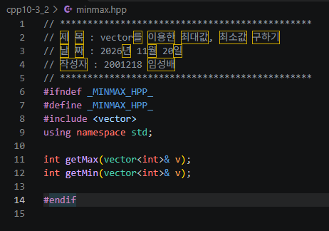 |
| minmax.cpp | 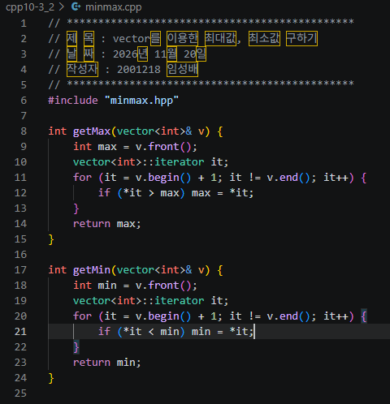 |
| main.cpp | 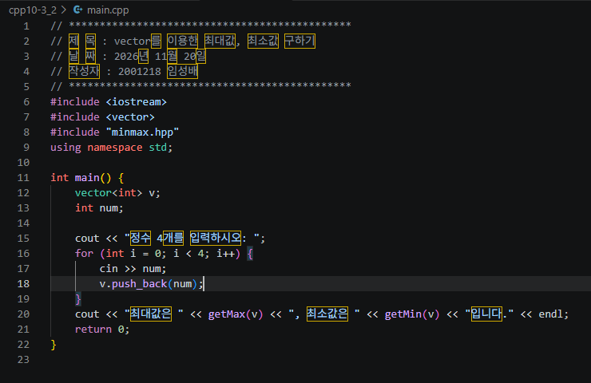 |
| Makefile | 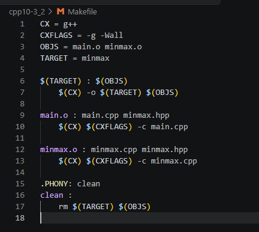 |
| 실행결과 | 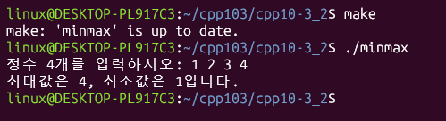 |

# 실습과제 3
vector 클래스를 이용하여 다음 처럼 동작하는 프로그램을 작성하시오. vector클래스와 멤버함수만을 이용하시오(배열표현은 사용금지)

## 대소문자를 구분하지 않고 비교하는 이유
- string의 > 연산자는 아스키코드 값으로 비교하므로 대문자(A~Z : 65~90)가 소문자(a~z : 97~122)보다 항상 작음
- 그대로 비교하면 hello, World, book, program, C++ 중 program이 제일 뒤에 나오는 단어가 됨
- 실제 사전처럼 대소문자를 구분하지 않으면 book, C++, hello, program, World 순서이므로 실행 예시처럼 World가 제일 뒤에 나옴
- 따라서 두 단어를 소문자로 바꾼 뒤 비교하고, 출력은 입력한 원래 단어로 함

## words.hpp
```cpp
#ifndef _WORDS_HPP_
#define _WORDS_HPP_
...
#endif
```
- 헤더파일 중복 포함 방지

```cpp
string toLower(string s);
string lastWord(vector<string>& sv);
```
- 문자열을 소문자로 바꾸는 함수와, 벡터에서 사전 순으로 제일 뒤의 단어를 찾는 함수 선언

## words.cpp
```cpp
#include <cctype>
#include "words.hpp"
```
- tolower() 함수를 사용하기 위해 cctype 포함

```cpp
string toLower(string s) {
    string::iterator it;
    for (it = s.begin(); it != s.end(); it++)
        *it = tolower(*it);
    return s;
}
```
- s는 값으로 전달받은 복사본이므로 원래 단어는 바뀌지 않음
- string도 iterator를 제공하므로 s[i] 대신 iterator로 한 문자씩 순회
- tolower()로 대문자를 소문자로 변환, 소문자나 기호(+)는 그대로 유지

```cpp
string lastWord(vector<string>& sv) {
    string last = sv.front();
```
- 첫 번째 단어를 제일 뒤의 단어로 가정

```cpp
    vector<string>::iterator it;
    for (it = sv.begin() + 1; it != sv.end(); it++) {
        if (toLower(*it) > toLower(last))
            last = *it;
    }
    return last;
}
```
- 두 번째 단어부터 iterator로 순회
- 소문자로 바꾼 문자열끼리 비교하여 사전 순으로 더 뒤에 있으면 교체
- 저장은 원래 단어 *it로 하므로 출력할 때 World처럼 입력한 대소문자가 유지됨

## main.cpp
```cpp
vector<string> sv;
string word;
```
- string 타입 원소를 저장하는 벡터 sv 생성

```cpp
for (int i = 0; i < 5; i++) {
    cout << "문자열을 입력하세요: ";
    getline(cin, word);
    sv.push_back(word);
}
```
- getline()으로 한 줄을 입력 받아 push_back()으로 벡터에 추가, 5번 반복

```cpp
cout << "사전에서 제일 뒤에 나오는 단어는 " << lastWord(sv) << " 입니다." << endl;
```
- lastWord()를 호출하여 결과 출력

## Makefile
```makefile
CX = g++
CXFLAGS = -g -Wall
OBJS = main.o words.o
TARGET = words
```
- 컴파일러(g++), 컴파일 옵션(-g 디버그 정보, -Wall 모든 경고), 목적파일 목록, 실행파일 이름을 변수로 지정

```makefile
$(TARGET) : $(OBJS)
	$(CX) -o $(TARGET) $(OBJS)
```
- 첫 번째 rule, g++ -o words main.o words.o로 링크

```makefile
main.o : main.cpp words.hpp
	$(CX) $(CXFLAGS) -c main.cpp

words.o : words.cpp words.hpp
	$(CX) $(CXFLAGS) -c words.cpp
```
- 각 소스파일을 목적파일로 컴파일, 소스파일이나 헤더파일이 수정되면 다시 컴파일됨

```makefile
.PHONY: clean
clean :
	rm $(TARGET) $(OBJS)
```
- make clean 입력 시 실행파일과 목적파일 삭제

```
문자열을 입력하세요: hello
문자열을 입력하세요: World
문자열을 입력하세요: book
문자열을 입력하세요: program
문자열을 입력하세요: C++
사전에서 제일 뒤에 나오는 단어는 World 입니다.
```
## 실행결과
| 구분 | 이미지 |
| --- | --- |
| words.hpp | 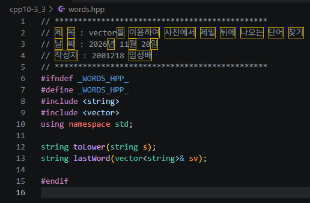 |
| words.cpp | 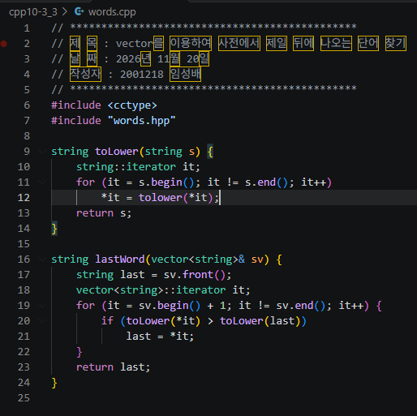 |
| main.cpp | 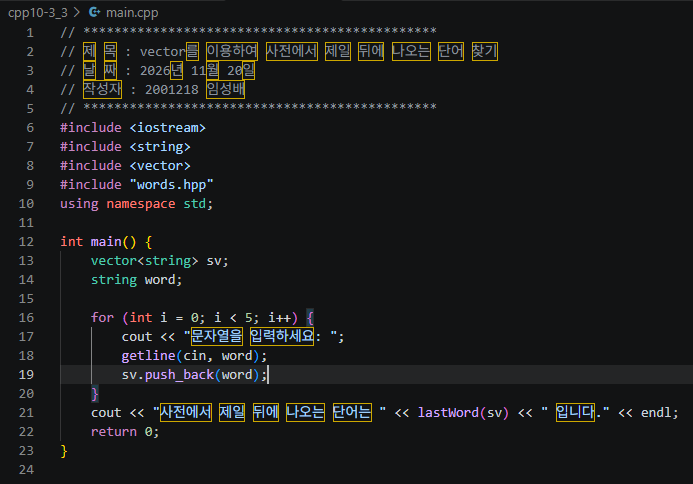 |
| Makefile | 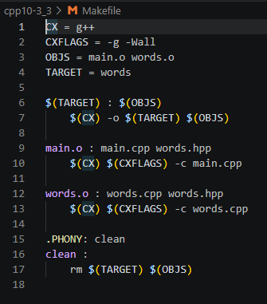 |
| 실행결과 | 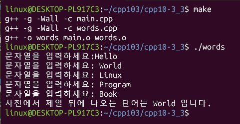 |

# 실습과제 4
키보드로부터 정수 5개를 입력 받아 vector객체에 저장하고 벡터 객체에서 음수를 삭제(erase함수사용) 후 남은 벡터 원소들의 평균값을 구하시오.

## vecavg.hpp
```cpp
#ifndef _VECAVG_HPP_
#define _VECAVG_HPP_
...
#endif
```
- 헤더파일 중복 포함 방지

```cpp
void printVector(vector<int>& v);
void eraseNegative(vector<int>& v);
double average(vector<int>& v);
```
- 벡터 출력, 음수 삭제, 평균 계산 함수 선언
- eraseNegative()는 원래 벡터의 원소를 삭제해야 하므로 반드시 참조(&)로 전달

## vecavg.cpp
```cpp
void printVector(vector<int>& v) {
    vector<int>::iterator it;
    for (it = v.begin(); it != v.end(); it++)
        cout << *it << " ";
    cout << endl;
}
```
- iterator로 처음부터 끝까지 순회하며 원소 출력

```cpp
void eraseNegative(vector<int>& v) {
    vector<int>::iterator it = v.begin();
    while (it != v.end()) {
        if (*it < 0)
            it = v.erase(it);
        else
            it++;
    }
}
```
- it가 가리키는 원소가 음수이면 erase()로 삭제
- erase()는 삭제된 원소의 다음 원소를 가리키는 iterator를 리턴하므로 it에 다시 저장
- 삭제한 경우 it가 이미 다음 원소를 가리키므로 it++를 하지 않음, 삭제하지 않은 경우에만 it++
- 삭제 후에도 it++를 하면 연속된 음수를 건너뛰거나 end()를 넘어가는 오류가 발생할 수 있음

```cpp
double average(vector<int>& v) {
    int sum = 0;
    vector<int>::iterator it;
    for (it = v.begin(); it != v.end(); it++)
        sum += *it;
    return (double)sum / v.size();
}
```
- 모든 원소를 더한 뒤 size()로 원소 개수를 구해 나눔
- 정수끼리 나누면 소수점이 버려지므로 double로 형 변환

## main.cpp
```cpp
#include <iomanip>
```
- setprecision()을 사용하기 위해 iomanip 포함

```cpp
cout << "숫자를 입력하세요: ";
for (int i = 0; i < 5; i++) {
    cin >> num;
    v.push_back(num);
}
cout << "초기 벡터 원소 : ";
printVector(v);
```
- 정수 5개를 입력 받아 벡터에 추가하고 초기 원소 출력

```cpp
eraseNegative(v);
cout << "음수를 삭제 후 벡터원소 : ";
printVector(v);
```
- 음수를 삭제한 후 남은 원소 출력

```cpp
if (v.empty())
    cout << "남은 원소가 없어 평균을 구할 수 없습니다." << endl;
else
    cout << "평균값 : " << fixed << setprecision(1) << average(v) << endl;
```
- 입력이 모두 음수이면 원소가 없어 0으로 나누게 되므로 empty()로 먼저 확인
- fixed와 setprecision(1)로 소수점 아래 한 자리까지 출력하여 3이 아닌 3.0으로 표시

## Makefile
```makefile
CX = g++
CXFLAGS = -g -Wall
OBJS = main.o vecavg.o
TARGET = vecavg
```
- 컴파일러(g++), 컴파일 옵션(-g 디버그 정보, -Wall 모든 경고), 목적파일 목록, 실행파일 이름을 변수로 지정

```makefile
$(TARGET) : $(OBJS)
	$(CX) -o $(TARGET) $(OBJS)
```
- 첫 번째 rule, g++ -o vecavg main.o vecavg.o로 링크

```makefile
main.o : main.cpp vecavg.hpp
	$(CX) $(CXFLAGS) -c main.cpp

vecavg.o : vecavg.cpp vecavg.hpp
	$(CX) $(CXFLAGS) -c vecavg.cpp
```
- 각 소스파일을 목적파일로 컴파일, 소스파일이나 헤더파일이 수정되면 다시 컴파일됨

```makefile
.PHONY: clean
clean :
	rm $(TARGET) $(OBJS)
```
- make clean 입력 시 실행파일과 목적파일 삭제

```
숫자를 입력하세요: -5 6 -4 2 1
초기 벡터 원소 : -5 6 -4 2 1
음수를 삭제 후 벡터원소 : 6 2 1
평균값 : 3.0
```
## 실행결과
| 구분 | 이미지 |
| --- | --- |
| vecavg.hpp | 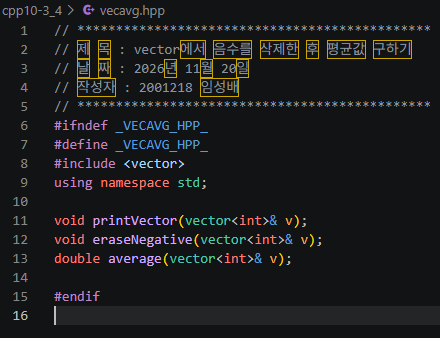 |
| vecavg.cpp | 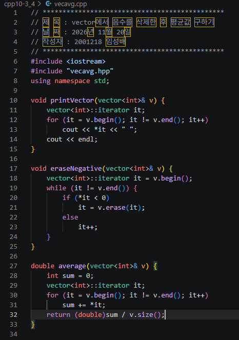 |
| main.cpp | 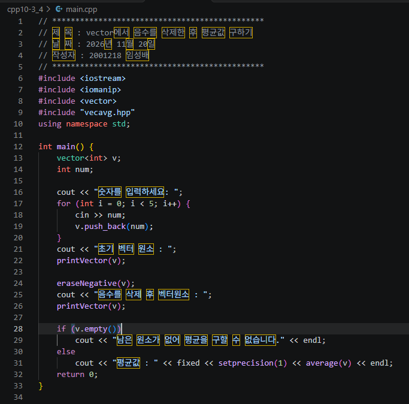 |
| Makefile | 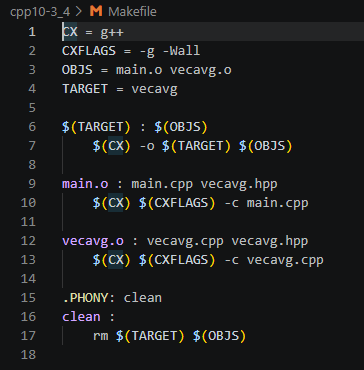 |
| 실행결과 | 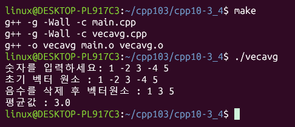 |

