# 8장 상속 실습과제

모든 과제는 리눅스에서 분할컴파일 구조로 작성하고 make로 빌드함

| 파일 | 내용 |
| --- | --- |
| shape.hpp | 헤더파일, 클래스 선언부 |
| shape.cpp | 소스파일, 클래스 구현부 |
| main.cpp | 메인함수 |
| Makefile | 빌드설정 |

빌드 및 실행 방법
```bash
$ cd cpp8_1
$ make
$ ./shapes
$ make clean
```

# 실습과제 1
위치좌표(x, y)를 멤버로 갖는 Shape 클래스를 선언하고 이를 상속한 파생클래스 Circle, Rect, Triangle 클래스를 작성하시오. Shape 클래스의 멤버변수 x, y는 private으로 선언할 것.

## shape.hpp (클래스 선언부)
```cpp
#ifndef _SHAPE_HPP_
#define _SHAPE_HPP_
...
#endif
```
- 헤더파일 중복 포함 방지(include guard), _SHAPE_HPP_가 정의되지 않았을 때만 아래 내용을 포함

```cpp
class Shape {
private:
    int x, y;
```
- 기본클래스 Shape 선언
- 위치좌표 x, y를 private으로 선언하여 파생클래스에서도 직접 접근 불가

```cpp
public:
    void setXY(int x, int y);
    void showXY();
```
- x, y는 private이므로 값을 설정하는 setXY()와 출력하는 showXY()를 public으로 제공
- 파생클래스는 이 함수들을 통해서만 x, y를 다룸

```cpp
class Circle : public Shape {
    int radius;
public:
    void setCircle(int x, int y, int radius);
    void show();
};
```
- Shape를 public 상속한 파생클래스 Circle
- 반지름 radius를 멤버로 가짐(클래스는 기본 접근지정이 private)
- 좌표와 반지름을 설정하는 setCircle(), 출력하는 show() 선언

```cpp
class Rect : public Shape {
    int width, height;
public:
    void setRect(int x, int y, int width, int height);
    void show();
};
```
- Shape를 public 상속한 파생클래스 Rect, 폭 width와 높이 height를 멤버로 가짐

```cpp
class Triangle : public Shape {
    int base, height;
public:
    void setTriangle(int x, int y, int base, int height);
    void show();
};
```
- Shape를 public 상속한 파생클래스 Triangle, 밑변 base와 높이 height를 멤버로 가짐

## shape.cpp (클래스 구현부)
```cpp
#include <iostream>
#include "shape.hpp"
using namespace std;
```
- cout, endl을 사용하기 위해 iostream 포함
- 클래스 선언부가 있는 shape.hpp 포함
- std:: 이름공간 생략

```cpp
void Shape::setXY(int x, int y) {
    this->x = x;
    this->y = y;
}
```
- 매개변수 x, y를 멤버변수 x, y에 저장
- 매개변수와 멤버변수의 이름이 같으므로 this->로 멤버변수를 구분

```cpp
void Shape::showXY() {
    cout << "좌표 (" << x << "," << y << ")에 ";
}
```
- "좌표 (x,y)에 "를 줄바꿈 없이 출력, 뒤에 파생클래스의 출력이 이어짐

```cpp
void Circle::setCircle(int x, int y, int radius) {
    setXY(x, y);
    this->radius = radius;
}
```
- x, y는 private이므로 직접 대입할 수 없고, 상속받은 기본클래스 멤버함수 setXY()로 설정
- 반지름은 Circle 자신의 멤버이므로 직접 저장

```cpp
void Circle::show() {
    showXY();
    cout << "반지름 " << radius << "인 원" << endl;
}
```
- 기본클래스 멤버함수 showXY()로 좌표를 먼저 출력
- 이어서 반지름 정보를 출력하고 줄바꿈

```cpp
void Rect::setRect(int x, int y, int width, int height) {
    setXY(x, y);
    this->width = width;
    this->height = height;
}
void Rect::show() {
    showXY();
    cout << "폭" << width << ", 높이" << height << "인 직사각형" << endl;
}
```
- Circle과 같은 방식으로 setXY()로 좌표를 설정하고 폭, 높이를 저장
- showXY()로 좌표를 출력한 뒤 폭, 높이를 출력

```cpp
void Triangle::setTriangle(int x, int y, int base, int height) {
    setXY(x, y);
    this->base = base;
    this->height = height;
}
void Triangle::show() {
    showXY();
    cout << "밑변" << base << ", 높이" << height << "인 삼각형" << endl;
}
```
- setXY()로 좌표를 설정하고 밑변, 높이를 저장
- showXY()로 좌표를 출력한 뒤 밑변, 높이를 출력

## main.cpp (메인함수)
```cpp
#include <iostream>
#include "shape.hpp"
using namespace std;
```
- cout, endl을 사용하기 위해 iostream 포함
- 클래스 선언부가 있는 shape.hpp 포함
- std:: 이름공간 생략

```cpp
Circle x; Rect y; Triangle z;
```
- 파생클래스 객체 x, y, z 생성, 각 객체 안에 기본클래스 Shape의 멤버도 함께 생성됨

```cpp
x.setCircle(0, 0, 2);
y.setRect(1, 1, 5, 10);
z.setTriangle(2, 2, 3, 4);
```
- 각 객체의 좌표와 크기를 설정

```cpp
x.show(); y.show(); z.show();
```
- 각 객체의 정보를 출력

## Makefile (빌드설정)
```makefile
CX = g++
```
- 사용할 C++ 컴파일러를 g++로 지정하는 변수

```makefile
CXFLAGS = -g -Wall
```
- 컴파일 옵션 변수, -g는 디버그 정보 포함, -Wall은 모든 경고 출력

```makefile
OBJS = main.o shape.o
```
- 링크에 필요한 목적파일 목록

```makefile
TARGET = shapes
```
- 생성할 실행파일 이름

```makefile
$(TARGET) : $(OBJS)
	$(CX) -o $(TARGET) $(OBJS)
```
- 첫 번째 rule이므로 make만 입력하면 실행됨
- shapes는 main.o와 shape.o에 의존하며, g++ -o shapes main.o shape.o로 링크

```makefile
main.o : main.cpp shape.hpp
	$(CX) $(CXFLAGS) -c main.cpp
```
- main.o는 main.cpp와 shape.hpp에 의존, g++ -g -Wall -c main.cpp로 컴파일

```makefile
shape.o : shape.cpp shape.hpp
	$(CX) $(CXFLAGS) -c shape.cpp
```
- shape.o는 shape.cpp와 shape.hpp에 의존, g++ -g -Wall -c shape.cpp로 컴파일

```makefile
.PHONY: clean
clean :
	rm $(TARGET) $(OBJS)
```
- clean은 실제 파일이 아닌 phony target
- make clean 입력 시 실행파일과 목적파일을 삭제

| 구분 | 이미지 |
| --- | --- |
| shape.hpp | 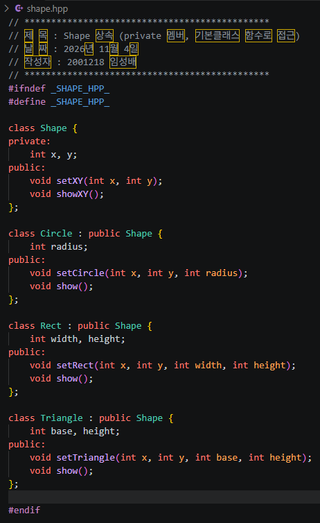 |
| shape.cpp | 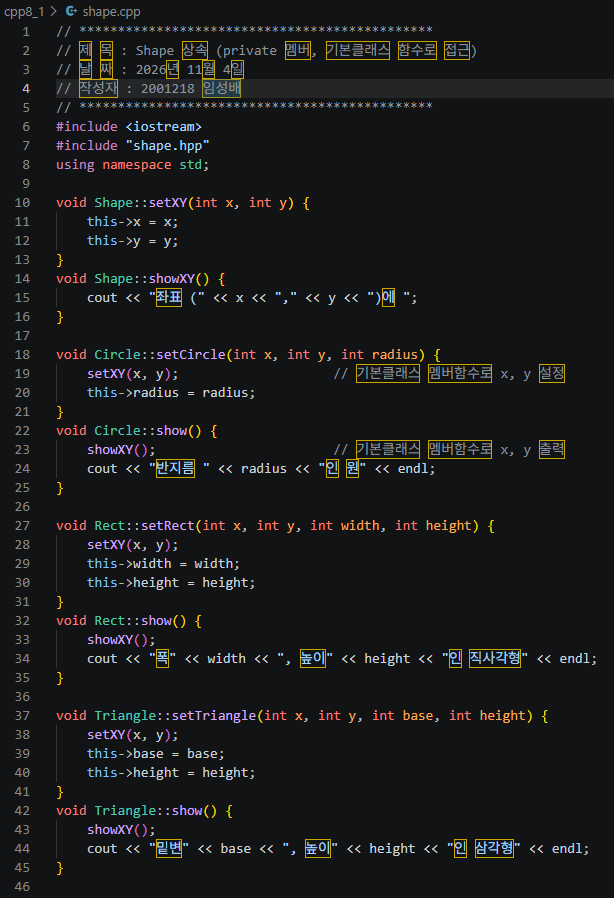 |
| main.cpp | 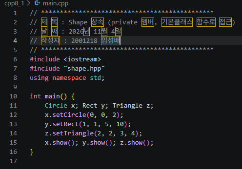 |
| Makefile | 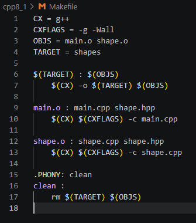 |
| 실행결과 | 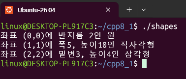 |

# 실습과제 2
실습과제 1번을 Shape 객체포인터를 이용하여 같은 결과를 얻도록 수정하시오. (업캐스팅 사용)

## shape.hpp (클래스 선언부)
```cpp
#ifndef _SHAPE_HPP_
#define _SHAPE_HPP_
...
#endif
```
- 헤더파일 중복 포함 방지(include guard), _SHAPE_HPP_가 정의되지 않았을 때만 아래 내용을 포함

```cpp
class Shape {
private:
    int x, y;
public:
    void setXY(int x, int y);
    void showXY();
};
```
- 실습과제 1과 동일, x, y는 private이며 setXY(), showXY()로 접근

```cpp
class Circle : public Shape {
    int radius;
public:
    void setRadius(int radius);
    void show();
};
```
- Shape 포인터로 좌표를 설정하도록 좌표 설정과 반지름 설정을 분리
- setRadius()는 반지름만 설정, show()는 반지름 부분만 출력

```cpp
class Rect : public Shape {
    int width, height;
public:
    void setSize(int width, int height);
    void show();
};
class Triangle : public Shape {
    int base, height;
public:
    void setSize(int base, int height);
    void show();
};
```
- Rect와 Triangle도 크기만 설정하는 setSize()와 크기 부분만 출력하는 show()를 가짐

## shape.cpp (클래스 구현부)
```cpp
#include <iostream>
#include "shape.hpp"
using namespace std;
```
- cout, endl을 사용하기 위해 iostream 포함
- 클래스 선언부가 있는 shape.hpp 포함
- std:: 이름공간 생략

```cpp
void Shape::setXY(int x, int y) { ... }
void Shape::showXY() { ... }
```
- 실습과제 1과 동일

```cpp
void Circle::setRadius(int radius) {
    this->radius = radius;
}
void Circle::show() {
    cout << "반지름 " << radius << "인 원" << endl;
}
```
- 반지름 저장 및 "반지름 2인 원" 부분 출력

```cpp
void Rect::setSize(int width, int height) { ... }
void Rect::show() {
    cout << "폭" << width << ", 높이" << height << "인 직사각형" << endl;
}
void Triangle::setSize(int base, int height) { ... }
void Triangle::show() {
    cout << "밑변" << base << ", 높이" << height << "인 삼각형" << endl;
}
```
- 각 도형의 크기 저장 및 크기 부분 출력

## main.cpp (메인함수)
```cpp
#include <iostream>
#include "shape.hpp"
using namespace std;
```
- cout, endl을 사용하기 위해 iostream 포함
- 클래스 선언부가 있는 shape.hpp 포함
- std:: 이름공간 생략

```cpp
Circle x; Rect y; Triangle z;
Shape* shape = nullptr;
```
- 파생클래스 객체 x, y, z 생성
- 기본클래스 Shape 타입의 객체 포인터 shape 선언, nullptr로 초기화

```cpp
shape = &x;
```
- 업캐스팅, 파생클래스 객체(Circle)의 주소를 기본클래스 포인터에 대입
- 명시적 형변환 없이 자동으로 가능

```cpp
shape->setXY(0, 0);
```
- 기본클래스 포인터로 기본클래스의 멤버함수 setXY() 호출

```cpp
((Circle*)shape)->setRadius(2);
```
- 기본클래스 포인터로는 기본클래스 멤버만 접근할 수 있으므로 파생클래스 멤버 setRadius()는 호출 불가
- (Circle*)로 다운캐스팅하여 파생클래스 멤버함수 호출, 다운캐스팅은 명시적 형변환이 필요

```cpp
shape = &y;
shape->setXY(1, 1);
((Rect*)shape)->setSize(5, 10);

shape = &z;
shape->setXY(2, 2);
((Triangle*)shape)->setSize(3, 4);
```
- Rect, Triangle 객체도 같은 방식으로 업캐스팅 후 좌표 설정, 다운캐스팅 후 크기 설정

```cpp
shape = &x;
shape->showXY();
((Circle*)shape)->show();
```
- 업캐스팅한 포인터로 showXY()를 호출해 좌표 출력
- 다운캐스팅하여 show()를 호출해 나머지 출력

```cpp
shape = &y;
shape->showXY();
((Rect*)shape)->show();

shape = &z;
shape->showXY();
((Triangle*)shape)->show();
```
- Rect, Triangle도 같은 방식으로 출력

## Makefile (빌드설정)
```makefile
CX = g++
```
- 사용할 C++ 컴파일러를 g++로 지정하는 변수

```makefile
CXFLAGS = -g -Wall
```
- 컴파일 옵션 변수, -g는 디버그 정보 포함, -Wall은 모든 경고 출력

```makefile
OBJS = main.o shape.o
```
- 링크에 필요한 목적파일 목록

```makefile
TARGET = shapes
```
- 생성할 실행파일 이름

```makefile
$(TARGET) : $(OBJS)
	$(CX) -o $(TARGET) $(OBJS)
```
- 첫 번째 rule이므로 make만 입력하면 실행됨
- shapes는 main.o와 shape.o에 의존하며, g++ -o shapes main.o shape.o로 링크

```makefile
main.o : main.cpp shape.hpp
	$(CX) $(CXFLAGS) -c main.cpp
```
- main.o는 main.cpp와 shape.hpp에 의존, g++ -g -Wall -c main.cpp로 컴파일

```makefile
shape.o : shape.cpp shape.hpp
	$(CX) $(CXFLAGS) -c shape.cpp
```
- shape.o는 shape.cpp와 shape.hpp에 의존, g++ -g -Wall -c shape.cpp로 컴파일

```makefile
.PHONY: clean
clean :
	rm $(TARGET) $(OBJS)
```
- clean은 실제 파일이 아닌 phony target
- make clean 입력 시 실행파일과 목적파일을 삭제

| 구분 | 이미지 |
| --- | --- |
| shape.hpp | 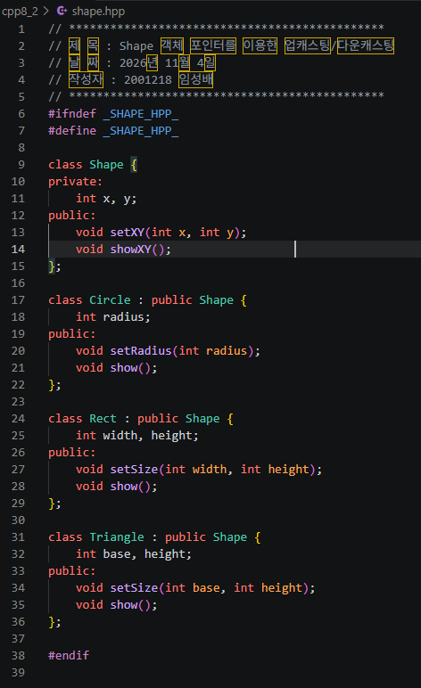 |
| shape.cpp | 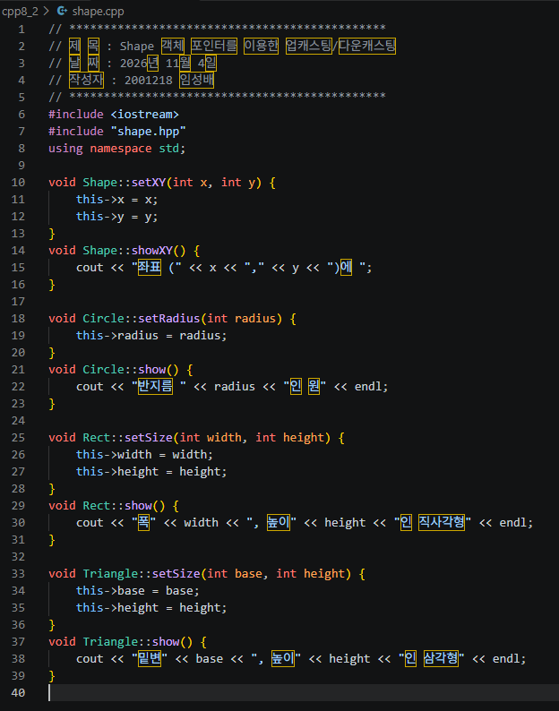 |
| main.cpp | 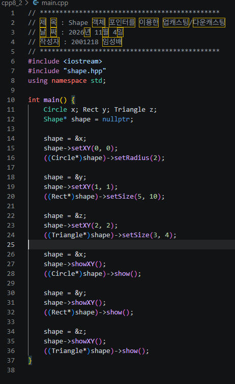 |
| Makefile | 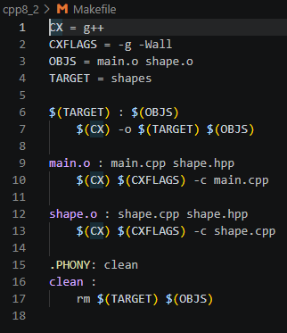 |
| 실행결과 | 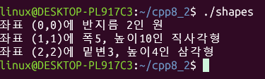 |

# 실습과제 3
실습과제 1과 같은 구조로 작성하되, Shape 클래스의 멤버변수 x, y는 protected로 선언할 것.

## shape.hpp (클래스 선언부)
```cpp
#ifndef _SHAPE_HPP_
#define _SHAPE_HPP_
...
#endif
```
- 헤더파일 중복 포함 방지(include guard), _SHAPE_HPP_가 정의되지 않았을 때만 아래 내용을 포함

```cpp
class Shape {
protected:
    int x, y;
public:
    void setXY(int x, int y);
};
```
- x, y를 protected로 선언
- protected 멤버는 외부(main)에서는 접근할 수 없지만 파생클래스에서는 직접 접근 가능
- 파생클래스가 x, y에 직접 접근하므로 showXY()는 필요 없음

```cpp
class Circle : public Shape { ... };
class Rect : public Shape { ... };
class Triangle : public Shape { ... };
```
- 실습과제 1과 동일하게 setCircle(), setRect(), setTriangle()과 show()를 선언

## shape.cpp (클래스 구현부)
```cpp
#include <iostream>
#include "shape.hpp"
using namespace std;
```
- cout, endl을 사용하기 위해 iostream 포함
- 클래스 선언부가 있는 shape.hpp 포함
- std:: 이름공간 생략

```cpp
void Circle::setCircle(int x, int y, int radius) {
    this->x = x;
    this->y = y;
    this->radius = radius;
}
```
- x, y가 protected이므로 기본클래스 함수를 거치지 않고 파생클래스에서 직접 대입

```cpp
void Circle::show() {
    cout << "좌표 (" << x << "," << y << ")에 반지름 " << radius << "인 원" << endl;
}
```
- 기본클래스의 protected 멤버 x, y를 직접 읽어서 좌표와 반지름을 한 번에 출력

```cpp
void Rect::setRect(int x, int y, int width, int height) { ... }
void Rect::show() {
    cout << "좌표 (" << x << "," << y << ")에 폭" << width << ", 높이" << height << "인 직사각형" << endl;
}
void Triangle::setTriangle(int x, int y, int base, int height) { ... }
void Triangle::show() {
    cout << "좌표 (" << x << "," << y << ")에 밑변" << base << ", 높이" << height << "인 삼각형" << endl;
}
```
- Rect, Triangle도 x, y에 직접 접근하여 설정 및 출력

## main.cpp (메인함수)
- 실습과제 1의 main.cpp와 동일

## Makefile (빌드설정)
```makefile
CX = g++
```
- 사용할 C++ 컴파일러를 g++로 지정하는 변수

```makefile
CXFLAGS = -g -Wall
```
- 컴파일 옵션 변수, -g는 디버그 정보 포함, -Wall은 모든 경고 출력

```makefile
OBJS = main.o shape.o
```
- 링크에 필요한 목적파일 목록

```makefile
TARGET = shapes
```
- 생성할 실행파일 이름

```makefile
$(TARGET) : $(OBJS)
	$(CX) -o $(TARGET) $(OBJS)
```
- 첫 번째 rule이므로 make만 입력하면 실행됨
- shapes는 main.o와 shape.o에 의존하며, g++ -o shapes main.o shape.o로 링크

```makefile
main.o : main.cpp shape.hpp
	$(CX) $(CXFLAGS) -c main.cpp
```
- main.o는 main.cpp와 shape.hpp에 의존, g++ -g -Wall -c main.cpp로 컴파일

```makefile
shape.o : shape.cpp shape.hpp
	$(CX) $(CXFLAGS) -c shape.cpp
```
- shape.o는 shape.cpp와 shape.hpp에 의존, g++ -g -Wall -c shape.cpp로 컴파일

```makefile
.PHONY: clean
clean :
	rm $(TARGET) $(OBJS)
```
- clean은 실제 파일이 아닌 phony target
- make clean 입력 시 실행파일과 목적파일을 삭제

| 구분 | 이미지 |
| --- | --- |
| shape.hpp | 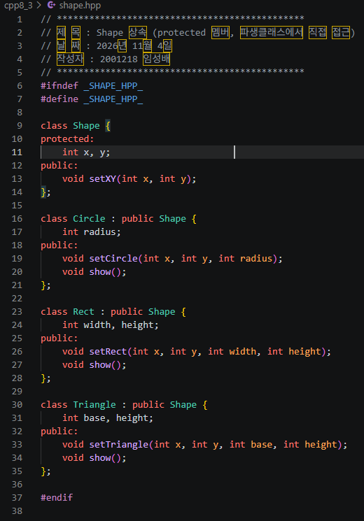 |
| shape.cpp | 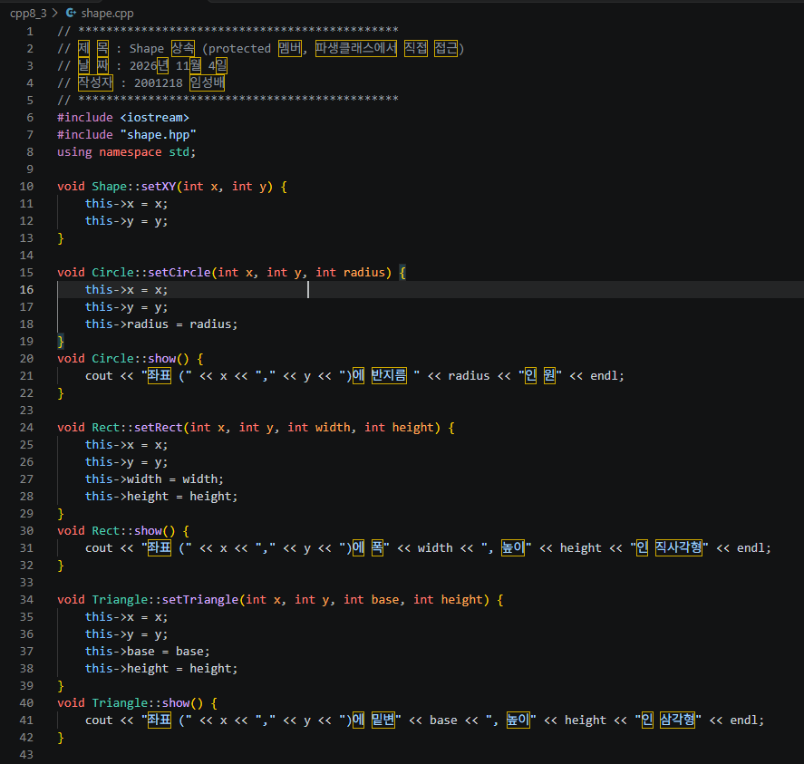 |
| main.cpp | 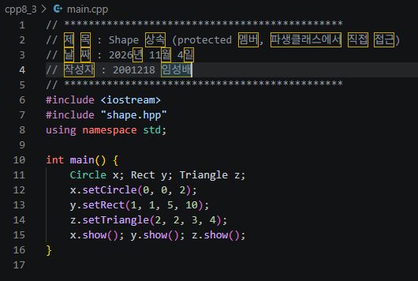 |
| Makefile | 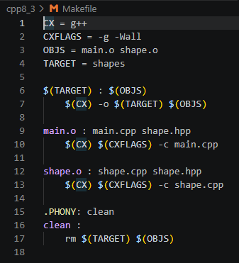 |
| 실행결과 | 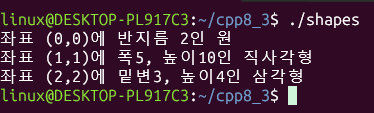 |
