# 실습과제 1
## 프로그램 개발과정 편집 선행처리 컴파일 링크 실행 단계를 자세히 설명하시오.
| 단계 | 하는 일 | 사용 프로그램 | 결과물 |
| --- | --- | --- | --- |
| 편집 | 에디터로 c언어 소스코드 작성 | 에디터 | main.c |
| 선행처리 | #으로 시작하는 명령문 처리. 헤더파일 내용을 그 자리에 삽입하고, 매크로를 몸체로 치환 | 선행처리기 | 수정된 소스코드 |
| 컴파일 | 선행처리된 소스코드를 기계어로 번역. 문법 오류는 이 단계에서 컴파일 오류로 표시 | 컴파일러 | main.obj |
| 링크 | 라이브러리 목적파일을 연결하여 하나의 실행파일 생성. 함수 정의를 찾지 못하면 링크 오류 | 링커 | Project1.exe |
| 실행 | 로더가 실행파일을 메모리에 올리고 cpu가 명령을 수행 | 로더 | 실행 결과 |

## 프로젝트 빌드 후 소스파일(c), 목적파일(obj), 실행파일(exe)의 위치를 -> 찾아보라 파일탐색기 검색화면을 첨부할 것
| 파일 | 이미지 |
| --- | --- |
| 소스파일(c) | 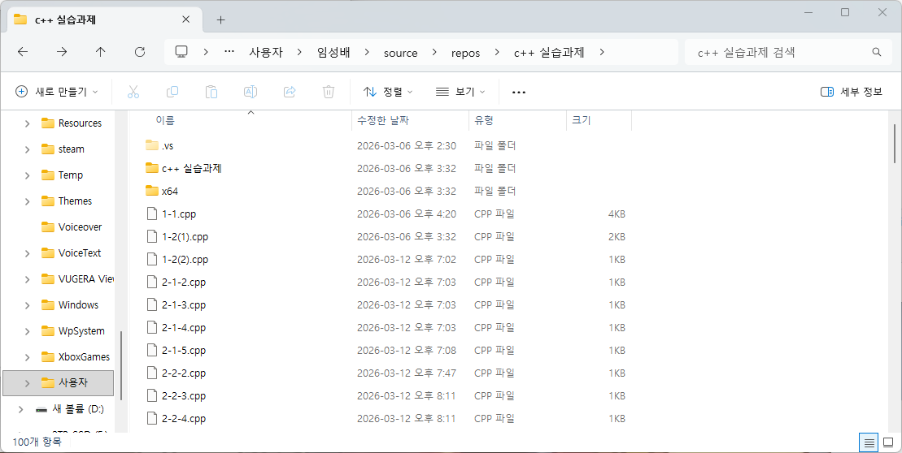 |
| 목적파일(obj) | 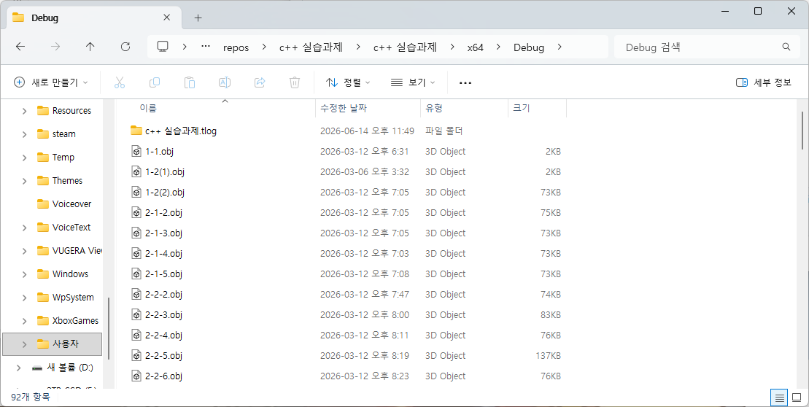 |
| 실행파일(exe) | 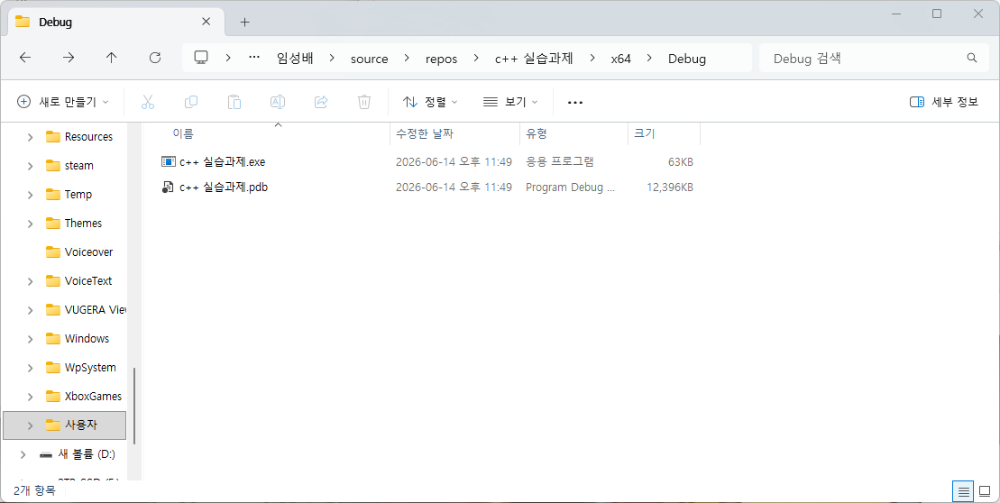 |

# 실습과제 2
## 매크로 상수를 사용한 예제를 인터넷에서 찾아서 실행해보고 소스코드를 자세히 설명하라
| 파일 | 이미지 |
| --- | --- |
| 코드 | 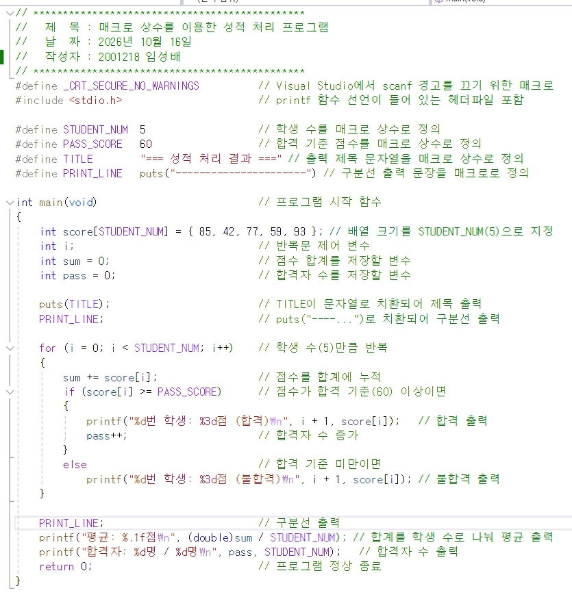 |
| 결과 | 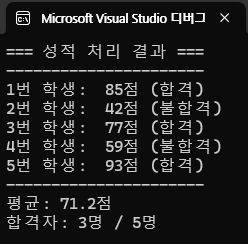 |
* 학생 수와 합격 점수, 제목, 구분선을 매크로로 정의하고 TITLE을 문자열 매크로, PRINT_LINE은 문장 전체를 치환하는 매크로.

# 실습과제 3
## #if elif ~ #endif 지시자를 사용하는 이유를 설명하라.
* 매크로 값에 따라 여러 코드 중 하나만 골라 사용하기 위함.
* if와 달리 선택되지 않은 코드는 선행처리 단계에서 아예 제거
* 하나의 소스로 여러 버전을 만들 수 있는 장점

## #if elif ~ #endif 지시자를 사용한 예제를 인터넷에서 찾아서 실행해보고 소스코드를 자세히 설명하라.
| 파일 | 이미지 |
| --- | --- |
| 코드 | 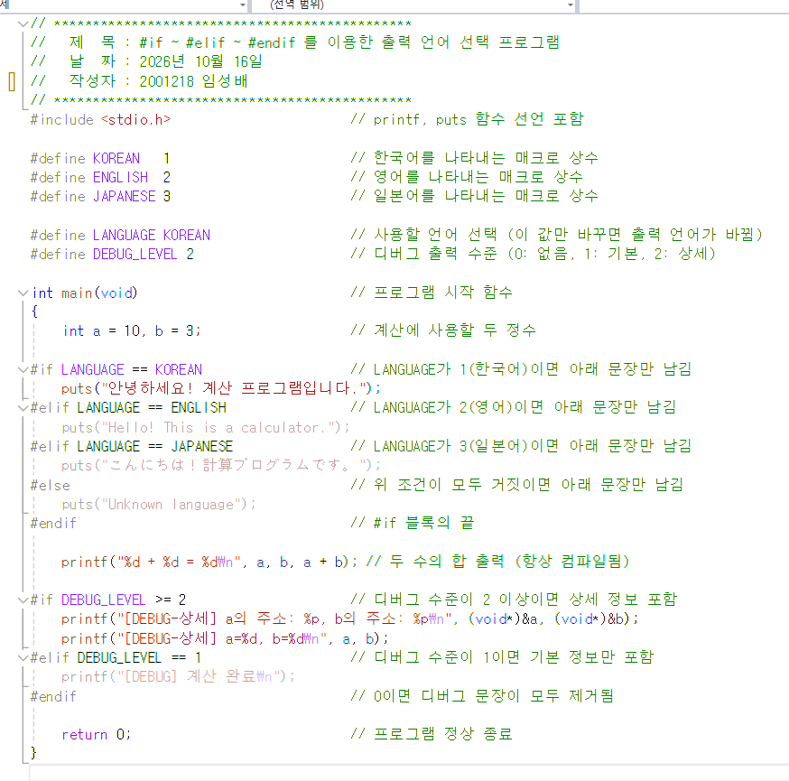 |
| 결과 | 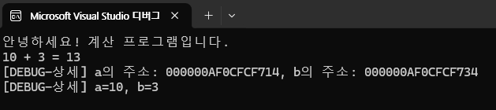 |
* LANGUAGE가 KOREAN(1)이므로 첫 번째 #if만 참이 되어 한국어 puts만 남음
* #define LANGUAGE ENGLISH로 바꾸면 영어 문장만 컴파일
* DEBUG_LEVEL이 2이면 상세 디버그 출력이, 1이면 기본 출력이 남고 0이면 디버그 코드가 모두 제거

# 실습과제 4
## #ifdef ~ #endif 지시자를 사용하는 이유를 설명하라.
* 매크로의 값이 아니라 정의되었는지만 확인해 코드를 넣거나 뺌. 용도는 디버그용 출력 코드.
* 개발 중에는 #define_DEBUG로 중간 과정 확인, 완성 후에는 이 한 줄만 지워 디버그 코드를 모두 제거.

## #ifdef ~ #endif 지시자를 사용한 예제를 인터넷에서 찾아서 실행해보고 소스코드를 자세히 설명하라.
| 파일 | 이미지 |
| --- | --- |
| 코드 | 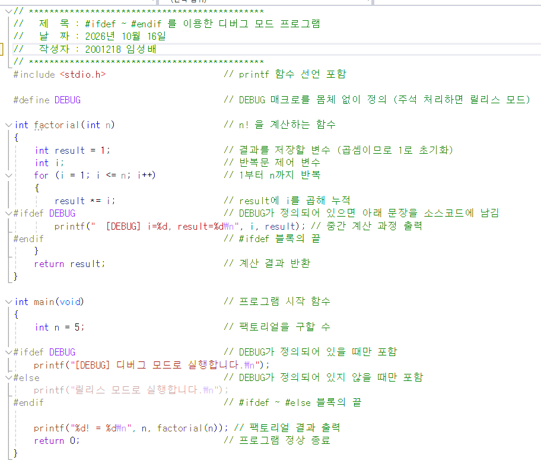 |
| 결과 | 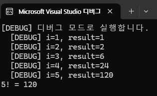 |
* #define_DEBUG는 몸체 없이 정의
* factorial() 안의 #ifdef DEBUG 블록이 반복마다 중간값을 출력
* #else를 함께 써서 DEBUG가 없으면 "릴리스 모드"문장이 남음
* #define_DEBUG 줄을 주석처리 하면 출력이 "릴리스 모드로 실행합니다."와 "5!=120" 두 줄만 남음.

# 실습과제 5
## ifndef ~ #endif 지시자를 사용하는 이유를 설명하라.
* 헤더파일 중복 포함을 막기 위함. 같은 헤더가 두 번 포함되면 구조체가 두 번 정의되어 컴파일 오류 발생.
* 처음 포함될 때만 내용이 들어가고, 이후엔 제외.
* 정의되어 있지 않으면 기본값을 정의하는 용도로 사용

## ifndef ~ #endif 지시자를 사용한 예제를 인터넷에서 찾아서 실행해보고 소스코드를 자세히 설명하라.
| 파일 | 이미지 |
| --- | --- |
| 코드 | 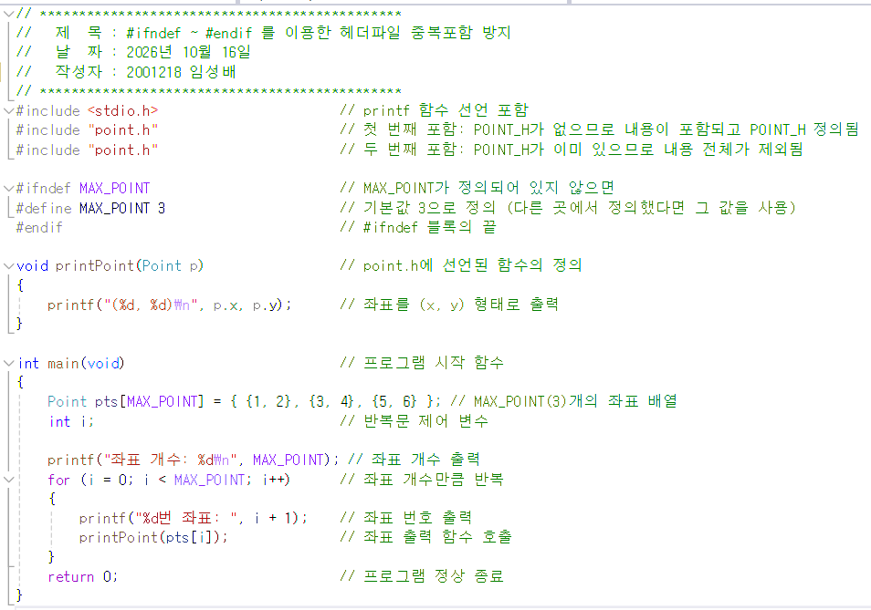 |
| 결과 | 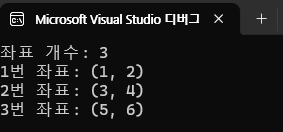 |
* point.h가 처음 포함될 때는 POINT_H가 없으므로 내용이 포함, 동시에 정의
* 두 번째 #include "point.h"에서는 #ifndef POINT_H가 거짓이 되어 내용 전체가 제외.
