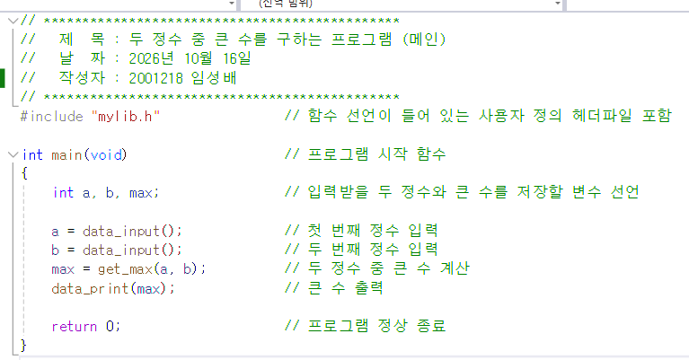
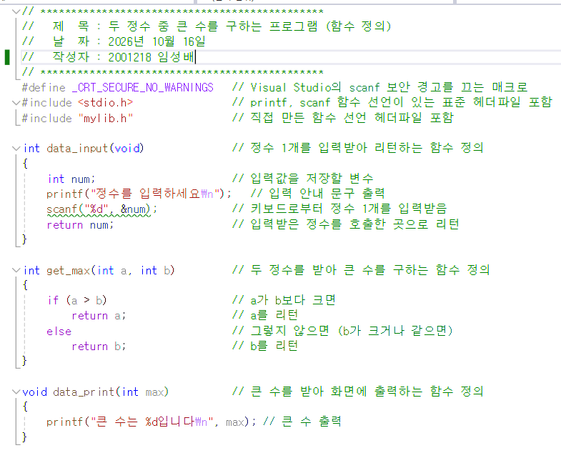
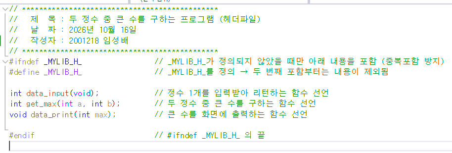
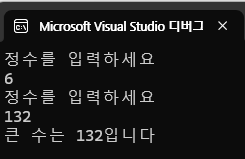
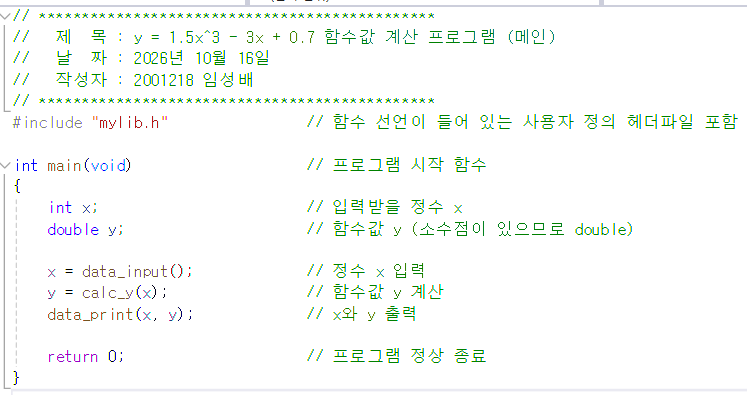
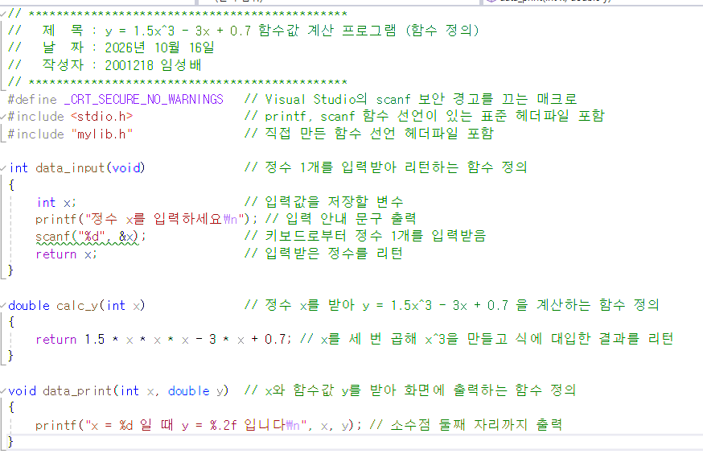
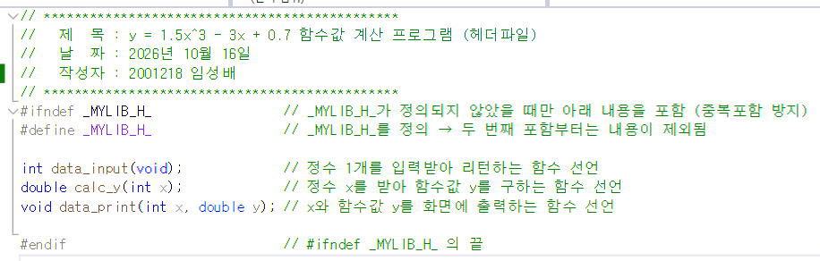
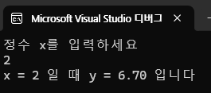

# 실습과제 1
## 두 개의 정수를 키보드로부터 입력 받아 둘 중 큰 수를 구하고 결과를 출력하는 프로그램을 작성하시오. 단, 다음 조건을 만족시키도록 코드를 작성하시오.
### 프로젝트의 구성 : main c, mylib h, mylib c(파일이름은 변경가능)
### main c : 필요한 변수선언 및 함수호출 문장만으로 구성할 것
### mylib c : 한 개의 정수를 입력 받아 리턴하는 함수 2 개의 정수를 받아 큰 수를 구하는 함수, 큰수를 화면에 출력하는 함수로 구성
### mylib h : mylib c 에서 정의한 함수의 선언문 및 기타 선행처리문

| 파일 | 이미지 |
| --- | --- |
| main.c |  |
| mylib.h |  |
| mylib.c |  |
| 실행결과 |  |

# 실습과제 2
## 1 개의 정수를 키보드로부터 입력 받아 아래 함수값을 출력하는 프로그램을 작성하시오 단 다음 조건을 만족시키도록 코드를 작성하시오.
* y = 1.5x³ − 3x + 0.7
### 프로젝트의 구성 main c, mylib h, mylib c(파일이름은 변경가능)
### main c : 필요한 변수선언 및 함수호출 문장만으로 구성할 것
### mylib c : 1 개의 정수를 입력 받아 리턴하는 함수 1 개의 정수를 받아 위 함수값을 구하는 함수 1 개의 정수를 받아 화면에 출력하는 함수로 구성
### mylib h : mylib c 에서 정의한 함수의 선언문 및 기타 선행처리문

| 파일 | 이미지 |
| --- | --- |
| main.c |  |
| mylib.h |  |
| mylib.c |  |
| 실행결과 |  |
* 일부 정수를 넣었을 때, 소수 부분이 잘리는 경우가 발생하여 int -> double로 임의 변경
