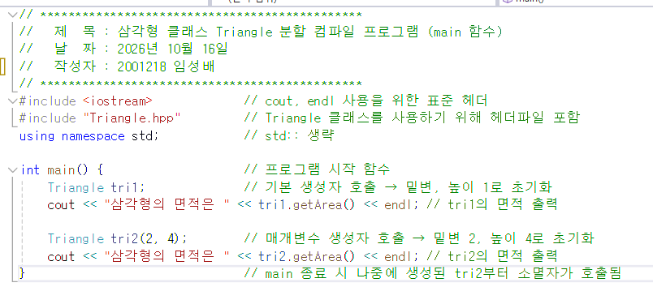
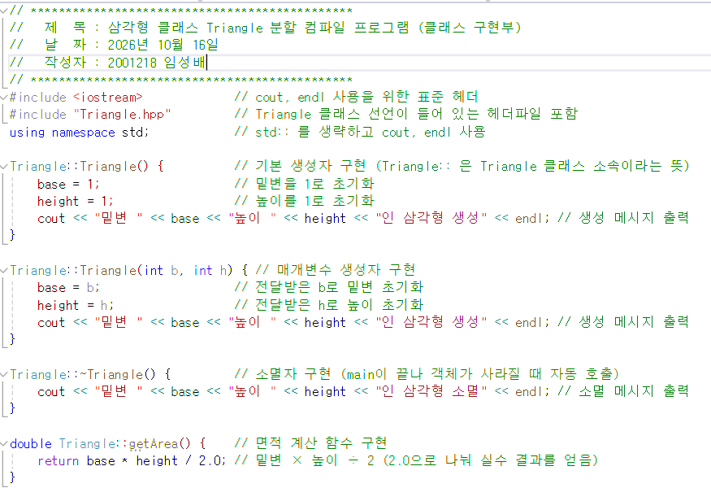
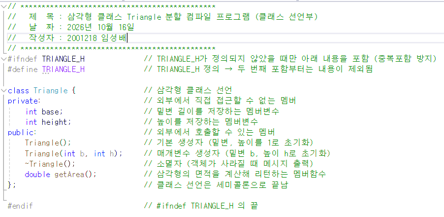
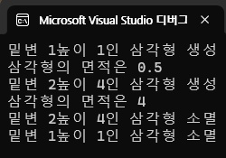
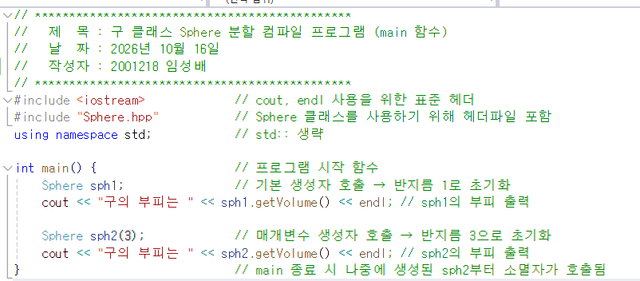
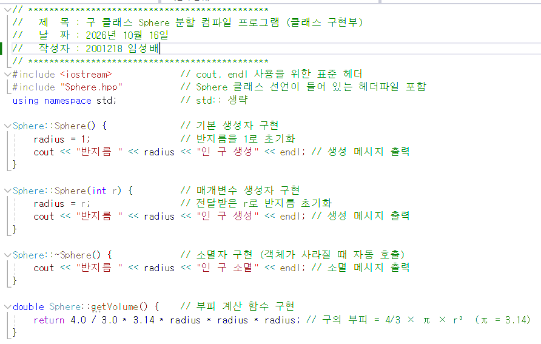
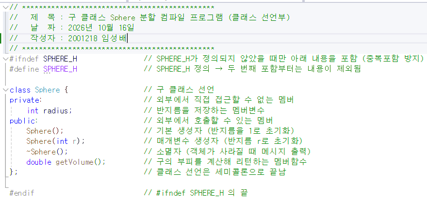
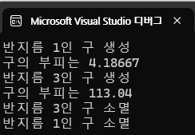

# 실습과제 1
## 삼각형 클래스 Triangle 를 만들고 다음 결과가 나오도록 멤버변수 , 멤버함수 , 생성자 , 소멸자를 구현하라
## 분할 컴파일 구조로 작성하라.
```
…
int main() {
  Triangle tri1; //밑변,높이 1로 초기화
  cout << ＂삼각형의 면적은 " << tri1.getArea() << endl;
  
  Triangle tri2(2, 4); //밑변=2,높이=4로 초기화
  cout << ＂삼각형의 면적은 " << tri2.getArea() << endl;
}
```
| 파일 | 이미지 |
| --- | --- |
| main.cpp |  |
| Triangle.cpp |  |
| Triangle.hpp |  |
| 실행결과 |  |

# 실습과제 2
## 구 클래스 Sphere 를 만들고 만들고 다음 결과가 나오도록 멤버변수, 멤버함수, 생성자, 소멸자를 구현하라.
## 분할 컴파일 구조로 작성하라.
```
…
int main() {
  Sphere sph1; // 반지름 =1로 초기화
  cout << “구의 부피는" << sph1.getVolume() << endl;

  Sphere sph2(3); // 반지름 =3로 초기화
  cout << ＂구의 부피는" << sph2.getVolume () << endl;
}
```
| 파일 | 이미지 |
| --- | --- |
| main.cpp |  |
| Sphere.cpp |  |
| Sphere.hpp |  |
| 실행결과 |  |
