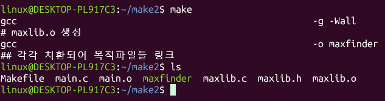
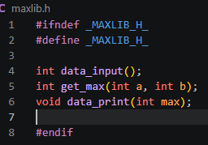
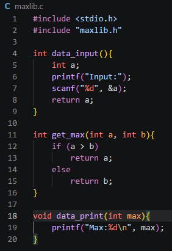
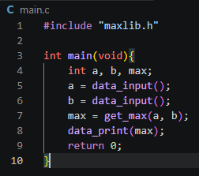
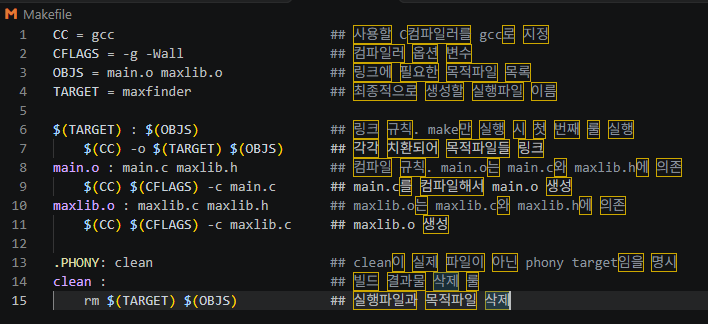
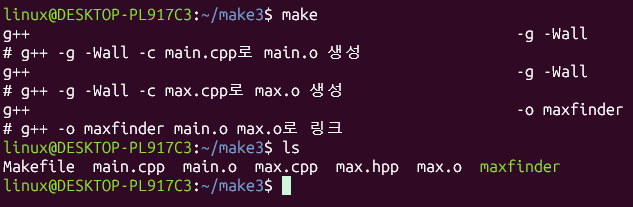
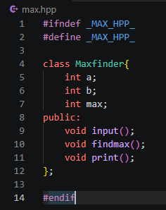
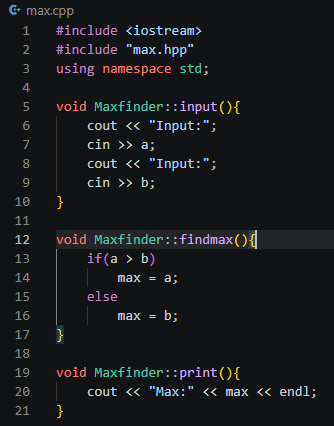
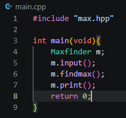
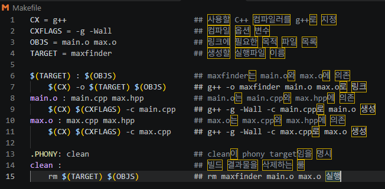

# 실습과제 1
## make, Makefile을 구분하여 차이점을 설명하라
| 구분 | make | Makefile |
| --- | --- | --- |
| 정체 | 실행 프로그램 | 텍스트 파일 |
| Makefile을 읽고 해석하여 빌드를 실제로 수행 | 프로그램을 어떻게 컴파일하고 링크할지 규칙으로 기술 |
| 작성/실행 | 터미널에서 make, make clean 등으로 실행 | vi나 vscode로 직접 작성 |
| 내용 | 타임스탬프를 비교해 필요한 규칙만 골라 실행 | 변수, target, prerequisites, recipe, phony target |

## 프로그램 개발과정에서 GNU Make는 왜 필요한가?
| 구분 | 이유 |
| --- | --- |
| 반복 작업의 자동화 | 소스파일이 여러 개이면 gcc -c main.c, gcc - c mylib.c 등의 명령어를 매번 직접 해야하지만, make를 쓰면 한 번으로 끝남 |
| 빌드 시간 단축 | make는 target과 prerequisites의 수정 시간을 비교하여 변경된 소스파일과 그에 의존하는 파일만 다시 컴파일 |
| 의존관계 관리 | 헤더파일이 바뀌면 이를 포함하는 목적파일들을 모두 다시 만들어야하지만, make가 알아서 올바른 순서로 처리 |

## 윈도우에서 사용한 Visual studio에서는 make의 역할을 누가하는가?
| 역할 | 내용 |
| Makefile의 역할 | 프로젝트 파일과 솔루션 파일이 맡음 |
| make의 역할 | MSBuild가 맡음 |

# 실습과제 2
## GCC 강의노트 실습과제 2번을 make로 빌드하시오.
| 구분 | 이미지 |
| --- | --- |
| make |  |

## 소스파일, Makefile, 실행 명령어와 결과를 제출하시오.
| 구분 | 이미지 |
| --- | --- |
| maxlib.h |  |
| maxlib.c |  |
| main.c |  |
| result |  |

# 실습과제 3
## GCC 강의노트 실습과제 3번을 make로 빌드하시오.
| 구분 | 이미지 |
| --- | --- |
| make |  |

## 소스파일, Makefile, 실행 명령어와 결과를 제출하시오.
| 구분 | 이미지 |
| --- | --- |
| maxlib.h |  |
| maxlib.c |  |
| main.c |  |
| result |  |
