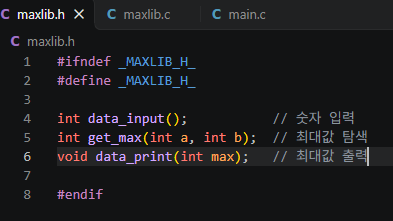
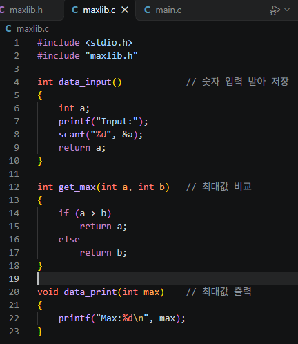
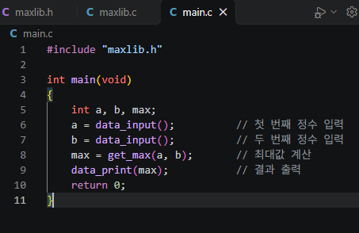
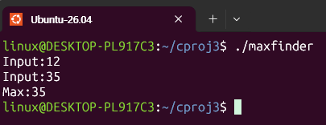
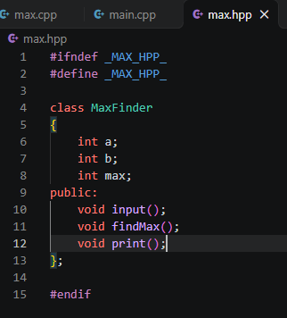
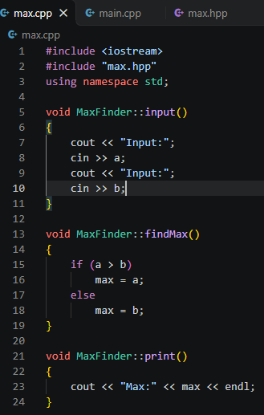
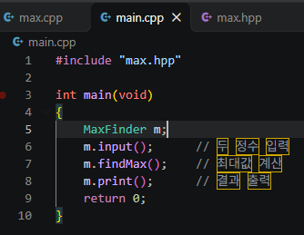
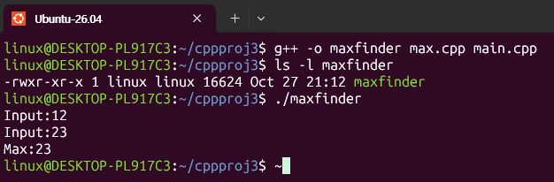

# 실습과제 1
## 정적라이브러리와 동적라이브러리의 차이를 설명하라 -> 정의, 링크시점, 장단점 등
| 구분 | 정적 라이브러리 | 동적 라이브러리 |
| --- | --- | --- |
| 정의 | 컴파일 된 함수 코드를 묶어놓은 파일 (.lib) | 런타임에 공유되어 로딩되는 라이브러리 파일 |
| 링크 시점 | 컴파일(빌드) 시점에 실행파일 안에 코드가 통째로 복사되어 포함됨 | 실행 시점(로드 타임)에 OS가 메모리에 올려서 여러 프로세스가 공유 |
| 실행파일 크기 | 라이브러리 코드가 포함되어 크기가 큼 | 라이브러리 코드를 포함하지 않아 크기가 작음 |
| 배포 | 실행파일 하나만 있으면 독립적으로 실행 가능 | 실행 시 해당 파일이 시스템에 있어야 함 |
| 장점 | 배포가 간단하고 실행 속도가 비교적 빠름 | 여러 프로그램이 메모리의 동일한 라이브러리를 공유해서 메모리를 절약 |
| 단점 | 라이브러리가 수정되면 모든 실행파일을 다시 빌드해야하고, 여러 프로그램이 같은 라이브러리르 쓰면 메모리가 낭비 | 실행 시 해당 라이브러리가 없으면 실행 불가하고, 함수 호출마다 약간의 오버헤드 발생 가능 |
## gcc의 -I, -l, -L, -g, -v 옵션의 기능을 설명하라
| 옵션 | 기능 |
| --- | --- |
| -I<headerdir> | 컴파일러가 헤더파일을 찾을 추가 디렉터리 경로를 지정 |
| -l<libname> | 링크할 라이브러리 이름을 지정 |
| -L<libpath> | -l로 지정한 라이브러리 파일을 찾을 디렉터리 경로를 지정 |
| -g | 디버그 정보를 포함하여 컴파일 |
| -v | 컴파일 과정에서 내부적으로 실행되는 모든 명령어를 화면에 출력 |
## 빌드 모드인 디버그모드(-g 옵션)와 릴리즈 모드(-O1,2,3 옵션)의 차이를 설명하라
| 구분 | 디버그 모드 | 릴리즈 모드 |
| --- | --- | --- |
| 목적 | 개발/디버깅 단계 | 배포/실제 운영 단계 |
| 코드 최적화 | 최적화를 하지 않거나 최소화 -> 소스코드와 실행코드가 1:1로 대응되어 디버거로 추적하기 쉬움 | 컴파일러가 코드를 적극적으로 최적화하여 실행 속도를 높이고 코드 크기를 줄임 |
| 디버깅 정보 | 변수명, 함수명, 라인 번호 들 심볼 정보를 바이너리에 포함 -> gdb로 한 줄씩 추적 가능 | 디버깅 정보가 없거나 디버깅이 어려움 |
| 실행 속도/크기 | 상대적으로 느리고 실행파일이 큼 | 더 빠르고 효율적인 실행파일 생성 |
| 안정성 | 최적화로 인한 예기치 않은 동작이 적어 버그 재현에 유리 | 최적화 과정에서 드물게 컴파일러 버그나 미묘한 동작 차이가 발생할 수 있음 |

# 실습과제 2
## 정수 2개를 입력 받아 최대값을 구하여 출력하는 C언어 코드를 분할 컴파일 구조로 작성하라.(예제 2번을 참고할 것)
## 프로젝트 디렉터리 cproj3를 생성하고 디렉터리 아래에 파일을 저장
## 입력기능, 최대값 구하기, 출력기능을 모두 함수로 만들 것
## 소스파일, 빌드 및 실행 명령어, 실행결과를 캡쳐하여 제출하시오.
| 구분 | 이미지 |
| --- | --- |
| maxlib.h |  |
| maxlib.c |  |
| main.c |  |
| result |  |

# 실습과제 3
## C++언어를 이용하여 실습과제1을 수행하시오.(예제 4번을 참고할 것)
## 프로젝트 디렉터리 cppproj3를 생성하고 디렉터리 아래에 파일을 저장
## 소스파일, 빌드 및 실행 명령어, 실행결과를 캡쳐하여 제출하시오.
| 구분 | 이미지 |
| --- | --- |
| max.hpp |  |
| max.cpp |  |
| main.c |  |
| result |  |
